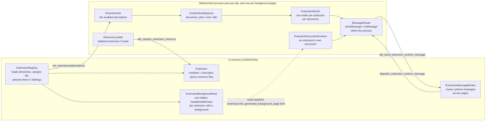
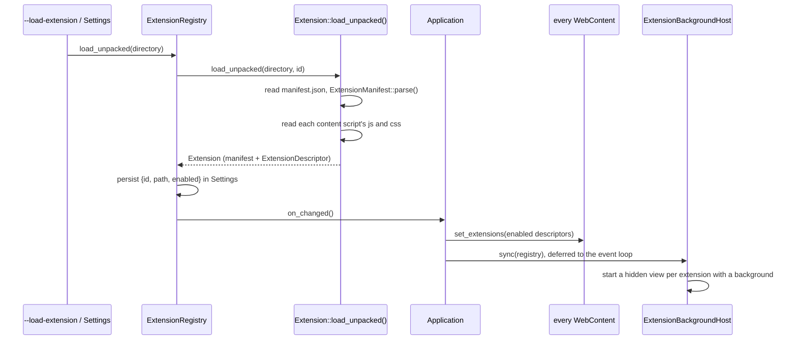
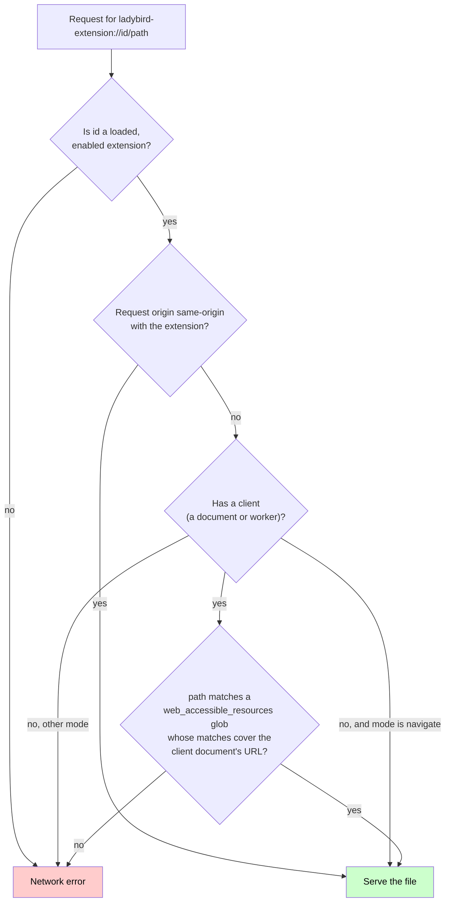
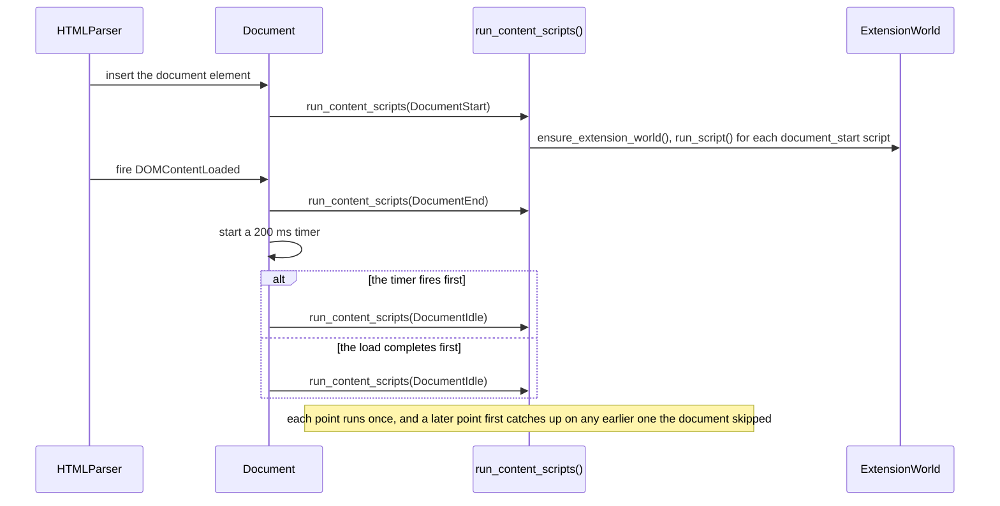
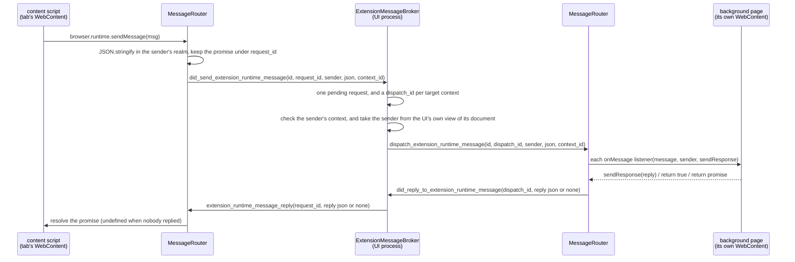

# Extensions support

Ladybird can load WebExtensions — the cross-browser extension model — from an unpacked directory. An extension’s content scripts run on the pages its manifest matches, in a JavaScript world of their own; its background scripts run in a hidden page of their own; and a content script talks to the extension’s own pages, its background page among them, through `browser.runtime.sendMessage()` and `browser.runtime.onMessage`.

The mechanism follows Ladybird’s process model: the UI process reads extension directories, keeps the registry of installed extensions, serves their files, hosts their background pages, and routes their messages; a WebContent process only ever sees a descriptor of each enabled extension, with the content-script sources already read for it.

This document is for two audiences. The first part is for people who want to use or write an extension; the rest is for maintainers reviewing or extending the implementation.

> [!NOTE]
> What’s described here is extensions support for content scripts, extension pages and resources, runtime messaging, background pages, and local storage. There’s no toolbar button, popup, `tabs`, or `about:extensions` page yet. The _Future work_ section at the end lists what’s planned.

## Using extensions

### Loading an unpacked extension

Pass the directory that holds the extension’s `manifest.json` on the command line:

```sh
ladybird --load-extension /path/to/my-extension
```

The flag can be repeated. Each directory is loaded, assigned an id, and recorded in the browser’s settings as its real, absolute path, so it loads again on every later start without the flag, whatever directory the browser starts in. A directory that’s already recorded — under any spelling of its path — keeps its id and whether it’s enabled when it’s loaded again, and is re-read from disk, which is how to pick up edits to the extension: Quit the browser and start it again (or start it again with the flag).

An extension that can’t be loaded isn’t installed; the error names the offending manifest key or the file that couldn’t be read:

```
Could not load the extension in /path/to/my-extension: manifest.json: "content_scripts" entries need a non-empty "matches" array
```

Installed extensions are enabled by default. There’s no UI yet for listing, disabling, or removing them; until the `about:extensions` page exists, that’s done by editing the `extensions` array in the settings file, where each entry is the extension’s `id`, its `path`, and whether it’s `enabled`.

### What an extension gets

An existing WebExtension works unchanged when it uses only the supported features:

- **Content scripts**, declared in the manifest’s `content_scripts`: JavaScript and CSS injected into every page that matches, at `document_start`, `document_end`, or `document_idle`, in all frames or just the top one, in the extension’s own isolated world or (with `"world": "MAIN"`) the page’s.
- **Extension pages and resources**, at `ladybird-extension://<id>/<path>`: an extension’s own pages load any of its files, and web pages load the ones its `web_accessible_resources` expose.
- **A background page** (manifest version 2 `background.scripts` or `background.page`, or manifest version 3 `background.service_worker`, which runs as a page script rather than as a worker), hosted in a hidden page of its own as long as the extension is enabled.
- **The `browser` and `chrome` namespaces**, which are the same object, with `runtime.id`, `runtime.getURL()`, `runtime.getManifest()`, `runtime.sendMessage()`, `runtime.onMessage`, `runtime.connect()`, `runtime.onConnect`, and `runtime.lastError`.

- **Local storage**, with the `storage` permission: `storage.local` methods and change events shared by the extension’s contexts.

A minimal extension that does something visible:

```json
{
    "manifest_version": 3,
    "name": "Hello",
    "version": "1.0",
    "content_scripts": [{ "matches": ["<all_urls>"], "js": ["hello.js"], "css": ["hello.css"] }],
    "background": { "scripts": ["background.js"] }
}
```

```js
// hello.js, a content script: runs on every page, in its own world.
browser.runtime.sendMessage({ title: document.title }).then(reply => {
    console.log(`background said: ${reply}`);
});
```

```js
// background.js: runs once, in the extension's hidden background page.
browser.runtime.onMessage.addListener((message, sender, sendResponse) => {
    sendResponse(`hello from ${browser.runtime.id}, you sent ${message.title} from ${sender.url}`);
});
```

### Manifest keys

Both manifest versions are supported, and both will stay supported — an extension written against manifest version 2 won’t stop working. The parser reads these keys and ignores every other one:

| Key                                                                                                                  | Notes                                                                                                                                                                                    |
| -------------------------------------------------------------------------------------------------------------------- | ---------------------------------------------------------------------------------------------------------------------------------------------------------------------------------------- |
| `manifest_version`                                                                                                   | Required; 2 or 3.                                                                                                                                                                        |
| `name`, `version`                                                                                                    | Required.                                                                                                                                                                                |
| `description`, `default_locale`                                                                                      | `default_locale` names the fallback locale, and `description` is localized: see [Localization](#localization).                                                                           |
| `content_scripts[]`: `matches`, `exclude_matches`, `js`, `css`, `run_at`, `all_frames`, `match_about_blank`, `world` | `matches` is required and non-empty. `run_at` defaults to `document_idle`, `world` to `ISOLATED`.                                                                                        |
| `web_accessible_resources`                                                                                           | Version 2’s list of path globs (every page may load them), or version 3’s list of `{ "resources": [...], "matches": [...] }` objects.                                                    |
| `background`: `scripts`, `page`, `service_worker`, `type`                                                            | `scripts` and `service_worker` are wrapped in a generated page; `page` is loaded as is; `"type": "module"` makes the generated script tags modules.                                      |
| `content_security_policy`                                                                                            | Version 2’s policy string, or version 3’s object with an `extension_pages` entry. The default is `script-src 'self'; object-src 'self'`, which blocks inline scripts in extension pages. |
| `permissions`, `host_permissions`                                                                                    | Supported API permissions are `storage`, `unlimitedStorage`, and `tabs`; other names are ignored. Host patterns are parsed separately.                          |

Match patterns follow the usual grammar: `<all_urls>`, or `<scheme>://<host><path>` where the scheme is `*` (http, https, ws, and wss), `http`, `https`, `ws`, `wss`, `file`, or `ftp`; the host is `*`, `*.` followed by a domain, or a domain (and empty for `file`); and the path starts with `/` and may contain `*`. A host is parsed the way a URL’s host is, so a malformed one is an error, and an internationalized domain name or an IP address matches however a URL spells it. The path part is matched against the URL’s path plus its query string, and the port and fragment are ignored.

### Private windows

Extensions are off in private windows by default. Set an installed extension’s `allowed_in_private` Settings key to `true` to opt in. Its background page remains in the normal profile, and its `storage.local` data is shared with normal windows. Changing the setting through the registry updates running processes immediately.

### Permission grants

A first command-line installation grants the declared supported API permissions and saves them as `granted_permissions` in Settings. A reload keeps that grant set: Newly declared API permissions remain ungranted and are logged. Settings entries without this key have no API grants. The permission confirmation UI will arrive with `about:extensions`.

### The `runtime` API

`browser.runtime.sendMessage(message)` serializes the message as JSON and returns a promise. The message goes to each of the extension’s own pages that’s open — its background page, and any other page at its `ladybird-extension://` URL — except the one sending it; a content script never receives a runtime message. The promise rejects with “Could not establish connection. Receiving end does not exist.” when no receiving context has a listener, including when its background page fails to start. Otherwise, it resolves with the first reply, or with `undefined` once every listener has declined, and a message that can’t be serialized (a function, a cycle) rejects it.

The extension’s own id may come before the message, and an options object after it (empty, or with an `includeTlsChannelId` boolean, which does nothing); the id of another extension is an error, since there’s no messaging between extensions. With a callback as the last argument, `sendMessage()` returns `undefined` and calls the callback with the reply instead, and when the call fails, `runtime.lastError` is an object with a `message` while that callback runs — and `undefined` at any other time.

`browser.runtime.onMessage.addListener(listener)` registers `listener(message, sender, sendResponse)`. `sender.id` is the extension’s id and `sender.url` the URL of the document the message came from. A listener answers in one of three ways, and the first answer from any listener wins:

- call `sendResponse(reply)` before returning;
- return `true`, and call `sendResponse(reply)` later;
- return a promise, whose settled value is the reply (a rejection is a decline).

Any other return value is ignored; the listener has declined. `removeListener()` and `hasListener()` work as elsewhere. A content script can’t message another content script: That takes `tabs.sendMessage()`, which isn’t there yet.

`browser.runtime.getURL("images/icon.png")` returns `ladybird-extension://<id>/images/icon.png`, and `browser.runtime.getManifest()` returns a fresh parse of `manifest.json`.

### Ports

`runtime.connect()` returns a Port synchronously. It accepts an optional extension id and an optional `connectInfo` object, whose `name` is a string: `connect()`, `connect({ name })`, `connect(extensionId)`, or `connect(extensionId, { name })`. A lone string is an extension id, not a port name. Omitting the id or using the extension’s own id connects to its other extension pages, including its background. Content-script worlds never receive these connections; `tabs.connect()` isn’t supported.

Each receiving page with a `runtime.onConnect` listener gets a Port. Ports expose `name`, `error` (initially `null`), `postMessage(message)`, `disconnect()`, `onMessage`, and `onDisconnect`; only receiver Ports expose `sender`, with the same `id` and `url` fields as runtime messages. An `onMessage` listener receives `(message, port)`, and an `onDisconnect` listener receives `(port)`.

Messages use JSON. A value that can’t be serialized throws a TypeError synchronously and sends nothing. Opener messages wait until every target’s synchronous `onConnect` listeners have finished; each opening queue allows 1,024 messages before the channel disconnects with “Port message queue is full”. Messages from one sender arrive in send order. The opener sends to every receiver, and each receiver sends only to the opener.

Calling `disconnect()` twice is harmless, and never fires the caller’s own `onDisconnect`. A receiver that disconnects or goes away leaves the opener connected while another receiver remains. Closing the opener notifies every receiver. Disabled, removed, or reloaded extensions lose all their channels. A disconnected Port never reconnects, and `postMessage()` on it throws “Attempting to use a disconnected port object”.

When no target accepts, or another extension’s id is supplied, the Port disconnects asynchronously with “Could not establish connection. Receiving end does not exist.”. Before listeners run, the Port is disconnected and `port.error` holds an Error; `runtime.lastError.message` holds the same message only during those listeners, restoring any enclosing error afterward. A clean disconnect leaves `port.error` null and doesn’t change `runtime.lastError`.

### The `storage.local` API

The `storage` permission exposes `browser.storage` and `chrome.storage`. Granting `unlimitedStorage` alone doesn’t expose the namespace. Content scripts and extension documents share one store per extension, and extensions can’t read each other’s items.

- `get()` and `get(null)` return every item. A string selects one key, an array selects those keys, and an object supplies default values for missing keys. Empty arrays and objects select nothing. A stored `null` remains distinct from a missing key.
- `set(object)` updates the supplied keys atomically. Values follow JSON serialization; cycles and other serialization failures reject the call before any request is sent. Keys such as `__proto__` are ordinary data properties.
- `remove(stringOrArray)` deletes selected keys atomically; missing keys have no effect. `clear()` removes every item.
- `getBytesInUse()` and `getBytesInUse(null)` report total usage. A string or array selects keys. Each key is counted once, using its UTF-8 bytes plus its serialized JSON value’s bytes.
- `QUOTA_BYTES` is 10,485,760. The granted `unlimitedStorage` permission lifts that limit. An over-quota update changes nothing.

Each method returns a promise. With a final callback, it returns `undefined` and calls the callback on completion. Failures call it with no arguments and expose `runtime.lastError.message` only while it runs; promise calls reject with an error instead.

`storage.onChanged` listeners receive `(changes, "local")`, and `storage.local.onChanged` listeners receive `(changes)`. Each changed key has `oldValue`, `newValue`, or both, according to whether it existed before and after the write. Unchanged writes emit no event. Committed changes reach every live context of the extension, including the writer, in write order.

The UI process keeps `<profile data>/extensions/<id>/storage-local.json`, containing `{"formatVersion":1,"items":{...}}`. File IO runs on a worker. Each mutation replaces the file atomically before publishing its result. Write failures preserve the prior map; corrupt files and unsupported format versions report an error and remain in place for recovery. Temporary profiles keep the file under their temporary data directory.

Disabling an extension keeps its storage. Removing it through the registry first revokes its contexts, then queues deletion after outstanding writes. Deletion failures are logged. Editing an extension out of Settings directly doesn’t run that removal operation. Private windows require the extension’s opt-in and share its normal-profile storage. The removal confirmation UI comes with `about:extensions`.

### What isn’t there yet

- No `storage.sync` or `storage.session`; no `tabs`, `scripting`, `action`, `webNavigation`, `webRequest`, or `declarativeNetRequest`.
- No toolbar button, popup, options page, or `about:extensions`.
- No packaged extensions (`.xpi`, `.crx`, `.zip`): only unpacked directories.
- A manifest version 3 `service_worker` runs as a script of the generated background page, not as a worker, so `self`, `importScripts()`, and worker-only APIs aren’t there, while `window` and `document` are. An extension that only uses the `runtime` API won’t notice.
- Host permissions are recorded for APIs that use them; they don’t control declared content-script injection.

## Key concepts

### Manifest versions 2 and 3

Both exist in the wild and differ mostly in shape: version 2 lists `web_accessible_resources` as bare paths, mixes host patterns into `permissions`, holds `content_security_policy` as a string, and runs background scripts in a page; version 3 pairs web-accessible resources with the pages that may load them, splits `host_permissions` out, nests the policy under `extension_pages`, and runs a background service worker. Ladybird parses both into one model (`ExtensionManifest`), and will keep doing so.

### Content scripts, worlds, and the extension URL scheme

A **content script** is extension code that runs inside a web page. It sees the page’s live DOM but not the page’s JavaScript objects: it runs in an **isolated world**, a separate JavaScript realm whose global is a different wrapper of the same `Window`. An expando the page sets on `window` or on an element isn’t visible to the content script, and vice versa, so neither side can tamper with the other’s prototypes. A script that opts into `"world": "MAIN"` runs as one of the page’s own scripts instead, with no `browser` namespace.

Each extension gets an **id** when it’s installed: a UUID private to the profile. Its pages and files are addressed as `ladybird-extension://<id>/<path>`, and each extension’s URLs form one origin, distinct from every web origin and from every other extension. A page can’t tell which extensions are installed by probing those URLs, since it can’t guess the ids.

### Background page and messaging

An extension’s **background page** is where its long-lived logic runs: a hidden document at the extension’s own origin, with the `browser` namespace in its main realm, started when the extension is enabled. A content script sends **runtime messages** to the background page and the extension’s other pages, which answer them, each message a JSON value, routed through the UI process because every page may live in a different WebContent process.

## Architecture



The split follows one rule: **the extension directory is read only in the UI process.** A WebContent process is sandboxed and can’t read arbitrary files, so the UI process reads every content script and style sheet at load time and ships the source text inside the descriptor, and serves every other extension file on request, after checking that the requesting page may have it.

The three kinds of state, and who owns them:

| State                                                                | Where                                                                                | Lifetime                                                                                                          |
| -------------------------------------------------------------------- | ------------------------------------------------------------------------------------ | ----------------------------------------------------------------------------------------------------------------- |
| Installed extensions (id, directory, enabled)                        | `Settings`, under the `extensions` key; `ExtensionRegistry` holds the loaded objects | The profile                                                                                                       |
| Enabled extensions’ descriptors                                      | `ExtensionSet::the()` in each WebContent process                                     | Replaced wholesale on every `set_extensions`                                                                      |
| Per-document extension state (worlds, run_at progress, injected CSS) | `DOM::Document`                                                                      | The document; worlds are detached when the document is destroyed, or when their extension is reloaded or disabled |

## Loading an extension



`ExtensionRegistry::load_unpacked()` resolves the directory to its real path, then gives a new directory a fresh UUID and records it in Settings; a directory already in Settings, under any spelling, keeps its id. `restore_from_settings()` runs at startup (skipped in test mode, so tests never depend on the user’s installed extensions) and drops any entry whose directory no longer loads. Each load, and each change to whether an extension is enabled, gives it a new revision, so every process can tell the new instance from the one it replaced. Every change ends in `on_changed`, which drops the messaging contexts of a revision that’s gone, pushes the enabled descriptors to every live WebContent process, and resyncs the background host. A WebContent process that starts later gets the descriptors as part of its launch.

The background host can’t create a view inside `Application::initialize()` — a view needs the event loop and the session the browser’s own first view sets up — so its first sync is deferred to the loop’s first turn. And since a view’s destructor reaches back into the Application, the host is destroyed first in `~Application()`.

## The `ladybird-extension://` scheme

`ladybird-extension://<id>/<path>` is a fetch scheme (it’s in `FETCH_SCHEMES`, so navigations to it reach our loader instead of being handed to an external handler), a secure context, and a tuple origin: `URL::URL::origin()` returns `("ladybird-extension", <id>, null port)`, so two documents of one extension are same-origin with each other and with nothing else.

Loads go through `ResourceLoader::handle_extension_load_request()`. The generated background page is served from the descriptor itself; any other path is requested from the UI process. There, `canonical_resource_path()` decodes the path the same way for the access check and for the file it opens, refusing an encoded `/`, a backslash, a NUL, an empty segment, and any `..` above the root. `Extension::open_resource()` then opens it relative to a handle on the extension’s directory, requires a regular file, and checks that the opened file’s real location is inside that directory, so no symlink can lead out of it. The manifest, script, and CSS reads at load time go through the same opener. The file descriptor goes back through the same `handle_file_return` path that `file://` loads use. Every response carries:

| Header                         | Value                                                 |
| ------------------------------ | ----------------------------------------------------- |
| `Content-Type`                 | Guessed from the file name                            |
| `Content-Security-Policy`      | The manifest’s extension-pages policy, or the default |
| `Access-Control-Allow-Origin`  | `*`                                                   |
| `Cross-Origin-Resource-Policy` | `cross-origin`                                        |

### Who may load what

The decision is made in `Fetching.cpp`, at the point where a fetch hands off to the loader (`extension_resource_load_is_allowed()`), so navigations, subresource loads, and `fetch()` calls all go through it. The UI process checks every request again before it opens a file (see _Security model_):



So an extension’s own pages load anything of it; the browser itself (a URL typed in the address bar, or the background host) may navigate to any of its pages; and a web page gets only what the manifest exposes to that page’s URL. The CORS gate in `main_fetch` exempts the scheme because this check decides access, and the `Access-Control-Allow-Origin: *` header then lets a cross-origin `fetch()` of an exposed resource read the body.

## Content-script injection

Three `run_at` points, each reached once per document, hooked where the document reaches that state:

| `run_at`         | When                                                                                                     | Hook                                                                                         |
| ---------------- | -------------------------------------------------------------------------------------------------------- | -------------------------------------------------------------------------------------------- |
| `document_start` | The document element has just been inserted; nothing else has been parsed                                | `Document::children_changed()`                                                               |
| `document_end`   | Right after `DOMContentLoaded` fires                                                                     | `HTMLParser::the_end()`, which then arms the idle timer                                      |
| `document_idle`  | 200 ms after `DOMContentLoaded`, or when the document completely finishes loading, whichever comes first | `Document::schedule_content_script_idle_point()` and `Document::completely_finish_loading()` |



`run_content_scripts(document, up_to)` walks the points in order up to the one requested, skipping the ones already run, so a document that reaches a later state without having passed through an earlier hook still gets its earlier scripts: an `about:blank` document has no parser to fire `DOMContentLoaded`, so its `document_end` scripts run at idle; and a navigable’s initial `about:blank`, which gets its document element before it’s fully active, gets its scripts from the end of `LocalNavigable::initialize_navigable()` at whatever point it has reached.

For each enabled extension and each of its content scripts, `content_script_matches()` decides: a script without `all_frames` runs only in the top-level document; `exclude_matches` is checked before `matches`; and only when the script sets `match_about_blank`, an `about:blank` or `about:srcdoc` document is matched by the URL of its nearest same-origin parent or opener that isn’t one (`Document::url_for_extension_matching()`) — never by its base URL, which the page can set. Each CSS file becomes a style sheet of its own at author origin, parsed with its `ladybird-extension://` URL as its base, so its relative URLs and `@namespace` rules are its own. The sheets keep manifest order and come before the page’s own sheets in the cascade, so the page wins a tie, and they never show up in `document.styleSheets`. A script may navigate or destroy the document; nothing more runs in a document that’s no longer fully active, and the idle timer is stopped in `Document::destroy()`.

## Extension worlds

An `ExtensionWorld` is one extension’s realm in one document, created the first time one of its isolated-world scripts runs there (`Document::ensure_extension_world()`), and kept in the document’s map by extension id. It’s built on the wrapper architecture described in [WrapperArchitecture.md](WrapperArchitecture.md): a `WrapperWorld` of type `Extension`, a realm whose global object is that world’s wrapper of the document’s own `Window` (and whose global `this` is that world’s `WindowProxy` for the browsing context), its own `Intrinsics`, and a `HostDefined` that names the document’s principal realm. `initialize_window_web_interfaces()` then gives the realm the full set of Web IDL interfaces, so a content script sees the same DOM the page does, through wrappers the page never touches.

The scripts themselves are classic scripts parsed in the world’s realm but owned by the document’s environment settings object — `ClassicScript::create_in_realm()` exists for exactly that split — so a content script’s timers and fetches belong to the document as a page script’s do, while its globals, prototypes, and wrapper cache are its own. So are its uncaught errors: A classic script reports them to the global of the realm it was parsed in, and the `ErrorEvent` reaches only that world’s listeners. A `MAIN`-world script skips all of that and runs through `ClassicScript::create()` like one of the page’s own scripts.

`Document::destroy()` detaches every world before the document goes away: the realm and its wrapper cache are dropped, the world is unregistered from the `MessageRouter`, and any later `sendMessage()` through a namespace the script kept a reference to fails. A world is also detached once its extension is reloaded, disabled, or removed (the `MessageRouter` detaches every context whose descriptor the new extension set no longer holds), and the extension’s next script in that document gets a new world. Nothing of a detached world runs again: Its API functions fail or do nothing, and its event listeners, callbacks, promise jobs, and timers are skipped. What its scripts already did to the page stays, CSS included, and an already-loaded page doesn’t get the scripts of a reloaded or re-enabled extension until it navigates.

An object-valued `CustomEvent.detail`, `ErrorEvent.error`, `MessageEvent.data`, `PopStateEvent.state`, or `History.state` read from the world that made it is that object itself. Read from another world, it’s a structured clone made in the reader’s realm — or `null`, for a value that can’t be cloned — so an event never hands one world’s objects to another. The generated getters of the attributes marked `[CloneAcrossWorlds]` do that, so the implementation getters never see a realm.

## The `browser` namespace

`install_namespace()` defines `browser` and `chrome`, one object, on a realm’s global: in an `ExtensionWorld` for content scripts, and in the principal realm of any document at a loaded extension’s own URL (`ExtensionDocumentContext`, created in `Document::make_active()` before any of the document’s scripts run). Both kinds of context implement `MessagingContext`, the interface the router talks to: a realm, a descriptor, a listener list, the page, a `MessageSender` describing it, and whether it’s been detached.

The namespace is plain JavaScript objects and native functions built in `Extensions/API/`, not Web IDL interfaces: `Runtime.cpp` builds `runtime`, and `Event.cpp` builds an event object (`addListener`, `removeListener`, `hasListener`) over an `EventListenerList` GC cell the context owns.

## Runtime messaging



Within a process, `MessageRouter::the()` keeps the live contexts, each with an id of its own. `send()` serializes the message in the sender’s realm, fails the call when that fails, and hands the JSON to the page client, keeping the promise or callback under the sending context. `dispatch()` runs the `onMessage` listeners of the one context the message is addressed to, with a `ReplyCollector` that counts the listeners before any runs (so an early reply can’t finish the count under a later one) and calls exactly the ones it counted. It takes the first answer, and reports an empty reply once every listener has declined. `sendResponse` answers once; a later call, or one after the context is gone, does nothing. And a context that goes away drops its pending calls and declines any answer it still owed.

In the UI process, `ExtensionMessageBroker` keeps each context a page (an `Endpoint`) registers through `did_create_extension_context`, with its document’s id and the extension’s revision. It accepts a context only if the page hosts that document, the revision is current, and the document is either one of the extension’s own pages or one its content scripts match. The sender a receiver sees comes from that document’s URL as the UI process knows it, and the background flag from whether the page is the extension’s background view. A send goes to every context of the extension’s own pages except the sender’s — never to a content script — each under its own dispatch id. The first reply settles the sender’s request, and later ones are dropped; a reply counts only from the page its dispatch went to; and when every target has declined, or gone away (`endpoint_gone()` runs from `~WebContentPage()`), the sender learns that nobody replied. With no target at all, the sender gets that answer at once, unless the extension’s background page is still starting (see below).

Messages are JSON rather than structured clones, so a `Date` or a `Map` doesn’t survive the trip; that matches what extensions already expect from `sendMessage`.

## Background pages

`ExtensionBackgroundHost::sync()` keeps one hidden `HeadlessWebView` per enabled extension whose descriptor `has_background`, starting and stopping views as the registry changes, and replacing a view once its extension has a new revision. The view loads `ladybird-extension://<id>/_generated_background_page.html` — served from the descriptor’s `background_document_html`, a page of `<script src>` tags for `background.scripts` or the `service_worker`, with `type="module"` when the manifest says so — or the manifest’s own `background.page`. A background page whose WebContent process crashes is reloaded.

From the moment a background is due to start (`prepare()` runs before any descriptor goes out), the broker holds the messages sent to its extension, and delivers them once the page has loaded and its scripts have run. A failed load, a crash, a disable, a replacement, or 30 seconds without a finished load rejects them with the receiving-end error; after a crash, the page reloads, and new messages wait for it again.

Because the background page is an ordinary document at the extension’s origin, it gets its namespace through the same `ExtensionDocumentContext` that any extension page does. The UI process marks its messages as the background page’s when they come from the page in the extension’s background view — the manifest’s own `background.page` included — rather than by its path. It’s a full page in its own process, so it can use `fetch()`, timers, and the DOM, and it stays alive for as long as the extension is enabled; there’s no event-page idle unload yet.

## IPC endpoints

| Endpoint                                                                                                                                                     | Direction        | Purpose                                                                                       |
| ------------------------------------------------------------------------------------------------------------------------------------------------------------ | ---------------- | --------------------------------------------------------------------------------------------- |
| `set_extensions(extensions)`                                                                                                                                 | UI —> WebContent | Replace the process’s `ExtensionSet` with the enabled descriptors                             |
| `dispatch_extension_runtime_message(page_id, extension_id, dispatch_id, sender, message_json, context_id)`                                                   | UI —> WebContent | Deliver a runtime message to one context of the extension on the page                         |
| `extension_runtime_message_reply(page_id, request_id, reply_json)`                                                                                           | UI —> WebContent | Settle a `sendMessage()` promise the page is waiting on                                       |
| `did_request_extension_resource(page_id, extension_id, path, request_id)`                                                                                    | WebContent —> UI | Ask for a file of the extension; answered through `handle_file_return(error, fd, request_id)` |
| `did_create_extension_context(page_id, extension_id, context_id, document_id, revision)`, `did_destroy_extension_context(page_id, extension_id, context_id)` | WebContent —> UI | Register a context, with its document and the extension’s revision, or remove one             |
| `did_send_extension_runtime_message(page_id, extension_id, request_id, sender, message_json, context_id)`                                                    | WebContent —> UI | A `sendMessage()` to route                                                                    |
| `did_reply_to_extension_runtime_message(page_id, dispatch_id, reply_json)`                                                                                   | WebContent —> UI | The page’s answer (or decline) to one dispatch                                                |

The IPC-encodable types live in `LibWebCommon/Extensions/`, which both sides link: `ExtensionDescriptor` (with `ContentScriptDescriptor` and `WebAccessibleResourceDescriptor`), `MatchPattern`, `MessageSender`, and the scheme constants in `Scheme.h`.

Storage transport adds `did_request_extension_storage(page_id, context_id, request_id, request)` from WebContent to UI, plus `extension_storage_reply(page_id, request_id, result)` and `dispatch_extension_storage_changed(page_id, extension_id, changes_json)` in the other direction.

## Security model

- **A WebContent process never reads the extension directory.** It receives script sources in the descriptor and asks the UI process for everything else by id and path. The UI process opens the file through a handle on the extension’s directory, and refuses anything outside it, symlinks included.
- **Web pages get only web-accessible resources**, judged by the manifest and the requesting document’s URL (never its base URL), at one place in fetch. Everything else is a network error, which looks to the page like the resource doesn’t exist. The UI process checks again before it opens a file: The extension has to be enabled, and the requesting WebContent process has to host a document that may load the resource.
- **Extension ids are per-profile UUIDs**, so a page can’t probe for installed extensions at a URL that’s the same everywhere. An id isn’t a secret, though — a content script can reveal it — so every request is still checked.
- **Content scripts can’t be reached by the page.** Their realm, prototypes, and wrapper cache are separate; only the DOM is shared, an object an event carries from one world to another arrives as a clone, a content script’s uncaught errors stay in its world, and the page’s CSP doesn’t apply to them.
- **Extension pages get a CSP** of `script-src 'self'; object-src 'self'` unless the manifest sets one, so an extension page can’t run inline or remote script.
- **Storage requests require the granted `storage` permission.** The UI resolves each request against its registered page, document, and extension revision. It derives the extension id from that record and drops unknown or stale contexts. Renderers never open the storage file.

Known gaps: The UI process can’t yet tell which document of a WebContent process asked for a resource, so every document of a process that hosts one allowed document gets the same answer. It checks that a context’s document exists and that the extension’s content scripts match it, but it can’t prove that a script of that extension runs there. And on a platform with neither `F_GETPATH`, `/proc/self/fd`, nor `GetFinalPathNameByHandleW()`, every extension file read fails, rather than going unchecked.

## Tests

### Unit tests

| Test                                              | Covers                                                                                                                                        |
| ------------------------------------------------- | --------------------------------------------------------------------------------------------------------------------------------------------- |
| `Tests/LibWeb/TestExtensionMatchPattern.cpp`      | The pattern grammar, `<all_urls>`, wildcard hosts and paths, the query string, rejected patterns                                              |
| `Tests/LibWeb/TestExtensionDescriptor.cpp`        | IPC round trips and `is_web_accessible()`                                                                                                     |
| `Tests/LibWebView/TestExtensionManifest.cpp`      | Both manifest versions, every supported key, the generated background page, the error for each malformed key                                  |
| `Tests/LibWebView/TestExtensionRegistry.cpp`      | Install, reload, enable/disable, remove, restore from a Settings file, path normalization, revisions, resource access, background replacement |
| `Tests/LibWebView/TestExtensionMessageBroker.cpp` | Recipients, first reply wins, declines, a context or page going away, forged replies, startup queuing                                         |
| `Tests/LibWeb/TestExtensionWorld.cpp`             | Parsing in a foreign realm, world isolation, the namespace, `sendMessage` serialization, listener reply semantics, detach                     |

`TestExtensionStorageStore` covers exact quota accounting, atomic writes, unchanged values, operation order, reopening, corrupt files, write failure, and deletion. Registry and broker tests cover removal ordering, permissions, stale contexts, and change delivery.

### Text tests (`Tests/LibWeb/Text/input/Extensions/`)

These run under `test-web` with fixture extensions loaded from `Tests/LibWeb/Extensions/`, one subdirectory per fixture. That directory is the default for `--extensions-dir`, so ctest and the CI runners load the fixtures without being told:

```sh
Build/release/bin/test-web --test-path Tests/LibWeb -f 'Extensions/*'
```

`--extensions-dir` (by default, the `Extensions` directory under the test path) loads every subdirectory that has a `manifest.json`, in name order. A test finds its fixture’s id with `internals.extensionId(name)`, where `name` is the manifest’s `name`, since the id is a fresh UUID on every run. The fixtures’ `matches` patterns name the test files they apply to (`file:///*/Extensions/run-at-order.html`), so a fixture only ever runs in its own tests.

| Test                                  | Fixture               | Checks                                                                                            |
| ------------------------------------- | --------------------- | ------------------------------------------------------------------------------------------------- |
| `run-at-order`                        | `run-at`              | `document_start`, `document_end`, `document_idle` fire in order, once each                        |
| `css-injection`                       | `run-at`              | A content script’s CSS applies at author origin                                                   |
| `idle-timer-after-document-destroyed` | `run-at`              | A document destroyed before idle runs nothing and doesn’t crash                                   |
| `world-isolation`                     | `isolation`           | Page expandos aren’t visible to the content script, nor its to the page                           |
| `all-frames-about-blank`              | `frames`              | `all_frames` and `match_about_blank`                                                              |
| `exclude-matches`                     | `frames`              | `exclude_matches` wins over `matches`                                                             |
| `extension-page-loads`                | `resources`           | An extension page loads in an iframe, with its origin and its CSP                                 |
| `web-accessible-resource`             | `resources`, `locked` | Exposed resources load, unexposed ones and a locked extension’s don’t                             |
| `resource-path-cannot-escape`         | `resources`           | `..`, empty segments, and encoded separators are refused                                          |
| `send-message-round-trip`             | `messaging`           | `sendResponse`, `return true`, a returned promise, and `sender`                                   |
| `send-message-no-listener`            | `messaging-no-listener` | Rejects with the receiving-end error when no listener exists                                                     |
| `background-receives-from-mv2`        | `messaging-mv2`       | A manifest version 2 background page gets the message                                             |
| `css-file-origins`                    | `css-files`           | Each CSS file is an author sheet of its own: manifest order, its own namespaces, its own base URL |
| `about-blank-trusted-ancestry`        | `trusted-ancestry`    | An `about:blank` frame matches by its creator’s URL, never by a base URL the page set             |
| `world-values`                        | `world-values`        | Event payloads cross worlds as clones, and uncaught errors stay in their world                    |
| `background-to-content`               | `messaging`           | A content script never receives a runtime message                                                 |

The `storage-*` text tests cover selection forms and defaults, prototype-named keys, both change events across content and background contexts, callbacks and scoped errors, permission gating, and isolation between extensions. Each independent test has its own fixture identity so parallel runs don’t share mutable storage.

## File guide

### `Libraries/LibWebCommon/Extensions/`

- `MatchPattern.{h,cpp}`: The match-pattern grammar and matcher, plus `glob_matches()` for resource globs.
- `ExtensionDescriptor.{h,cpp}`: `ExtensionDescriptor`, `ContentScriptDescriptor`, `WebAccessibleResourceDescriptor`, their IPC encoding, and `is_web_accessible()`.
- `MessageSender.{h,cpp}`: Who sent a runtime message.
- `MessageResult.{h,cpp}` and `Storage.{h,cpp}`: Tagged runtime results and storage requests/results.
- `ResourcePath.{h,cpp}`: Decode and resolve an extension URL path, the same way for the access check and the open.
- `Scheme.h`: The scheme name and the generated background page’s path.

### `Libraries/LibWebView/Extensions/`

- `ExtensionManifest.{h,cpp}`: `manifest.json` parsing for both versions, and the generated background page.
- `Extension.{h,cpp}`: An unpacked extension: load it, and open a file inside it.
- `ExtensionRegistry.{h,cpp}`: The installed extensions, persisted through `Settings`.
- `ExtensionMessageBroker.{h,cpp}`: Cross-page message routing and storage authorization.
- `ExtensionStorageStore.{h,cpp}`: Serialized file operations, quota checks, and changed values.
- `ExtensionBackgroundHost.{h,cpp}`: The hidden views for background pages.

Elsewhere in LibWebView: `Settings.{h,cpp}` (the `extensions` key and `InstalledExtension`), `Application.{h,cpp}` (`--load-extension`, owning the registry, broker, and host, pushing descriptors), `WebContentPage.{h,cpp}` (the IPC handlers, and the `Endpoint` implementation).

### `Libraries/LibWeb/Extensions/`

- `ExtensionSet.{h,cpp}`: The process-wide set of enabled descriptors.
- `ExtensionWorld.{h,cpp}`: A content script’s realm in a document.
- `ExtensionDocumentContext.{h,cpp}`: The messaging context of an extension’s own document.
- `MessagingContext.h`: What the router needs from either.
- `ContentScriptInjector.{h,cpp}`: Matching and the three `run_at` points.
- `MessageRouter.{h,cpp}`: `sendMessage` and `onMessage` dispatch within a process.
- `Namespace.{h,cpp}`, `API/Runtime.{h,cpp}`, `API/Event.{h,cpp}`, `API/Storage.{h,cpp}`, `API/Completion.{h,cpp}`: The `browser`/`chrome` object.

Hooks elsewhere in LibWeb: `DOM/Document.{h,cpp}` (worlds, run_at bookkeeping, the idle timer, extension style sheets, the document context, `url_for_extension_matching()`), `HTML/Parser/HTMLParser.cpp` (`document_end`), `HTML/LocalNavigable.cpp` (the initial `about:blank`), `HTML/Scripting/ClassicScript.{h,cpp}` (`create_in_realm()`, and the realm errors are reported to), `Bindings/WorldSafeValue.{h,cpp}` and the `[CloneAcrossWorlds]` and `[FilterErrorEventByWorld]` IDL extended attributes in `Meta/Generators/libweb_bindings/` (cloning event payloads, and hiding error events, across worlds), `DOM/EventDispatcher.cpp`, `WebIDL/AbstractOperations.cpp`, `Bindings/MainThreadVM.cpp`, and `HTML/WindowOrWorkerGlobalScope.cpp` (skipping a detached world’s listeners, callbacks, jobs, and timers), `Fetch/Fetching/Fetching.cpp` (the access check and the scheme branch), `Fetch/Infrastructure/URL.h` (`FETCH_SCHEMES`), `Loader/ResourceLoader.{h,cpp}` (serving the scheme), `Page/Page.{h,cpp}` (the client hooks), `Internals/Internals.{idl,h,cpp}` (`extensionId()`), and `LibURL/Rust/src/origin.rs` (the origin).

### `Services/WebContent/`

`ConnectionFromClient.{h,cpp}` and `PageClient.{h,cpp}` carry the IPC messages in both directions; `WebContentServer.ipc` and `WebContentClient.ipc` declare them.

## Future work

Planned next, roughly in order:

- `tabs.query()` and `tabs.sendMessage()` basics.
- An `about:extensions` page: list, enable and disable, remove, load unpacked.
- Event-page idle unload for background pages.
- A toolbar button with a popup, `scripting.executeScript()`, `declarativeNetRequest` on the content blocker, `webNavigation`, observe-only `webRequest`, and a real background service worker.

## Localization

Every extension context has `browser.i18n` (also `chrome.i18n`), including
content scripts and background pages. It needs no permission.

- `getMessage(name, substitutions?, options?)` returns a message or an empty
  string for a missing name. Names and named placeholders are case-insensitive.
  A string supplies one substitution; an array supplies up to nine. An array
  longer than nine returns `undefined`, and elements whose string conversion
  throws are skipped. Other substitution values are ignored.
- Named `$placeholder$` values resolve when a catalog loads. At each API call,
  `$1` through `$9` insert positional substitutions, or an empty string for a
  missing position. A run of dollar signs loses its first dollar sign; any
  other dollar sequence loses the dollar sign and its following character.
  A trailing dollar sign is dropped.
- `{ escapeLt: true }` replaces less-than signs in the message with `&lt;`
  before positional substitution. It doesn’t escape the inserted values.
- `getUILanguage()` returns the configured language in BCP 47 form.

Catalogs live in `_locales/<locale>/messages.json`, with `default_locale` in
manifest.json. Each catalog maps message names to objects with a `message`
string and optional `placeholders` objects whose entries have a `content`
string. Every valid locale directory must have a valid catalog. Message and
placeholder names allow ASCII letters, digits, underscores, and `@`.

The first configured language selects the locale, falling back through its
parent tags and then `default_locale`, per message. Directory names use
underscores; matching ignores case and treats hyphens as underscores.
Language changes take effect when the extension reloads or the browser
restarts. A loaded extension keeps the same language throughout its contexts.

`__MSG_name__` tokens are replaced in the manifest’s `name`, `short_name`,
`description`, and `default_title` inside `action`, `browser_action`, and
`page_action`. `runtime.getManifest()` returns that localized manifest.
Undefined messages in those fields fail loading. Other manifest fields,
HTML, and JavaScript aren’t localized.

Declared content-script CSS and extension-scheme CSS, including imported
stylesheets, also replace these tokens. Unknown CSS tokens remain unchanged,
with a diagnostic, and replacement continues through the stylesheet. Inserted
text isn’t scanned again.

The built-in messages `@@extension_id`, `@@ui_locale`, `@@bidi_dir`,
`@@bidi_reversed_dir`, `@@bidi_start_edge`, and `@@bidi_end_edge` work even
without catalogs, including in CSS. `@@ui_locale` uses underscores, and the
bidirectional messages follow that locale’s writing direction. Catalogs
can’t redefine these names. `getAcceptLanguages()` and `detectLanguage()`
aren’t implemented.
