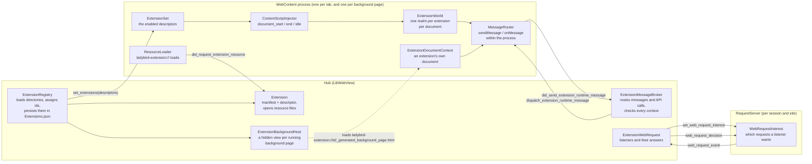
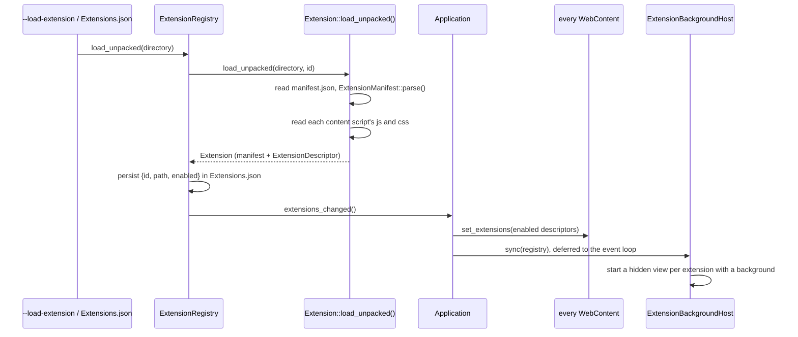
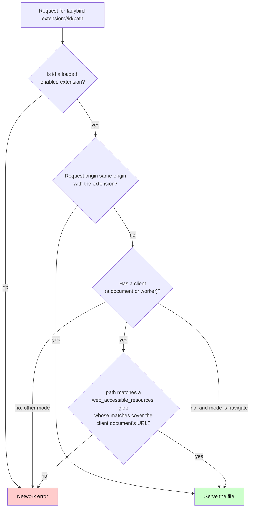
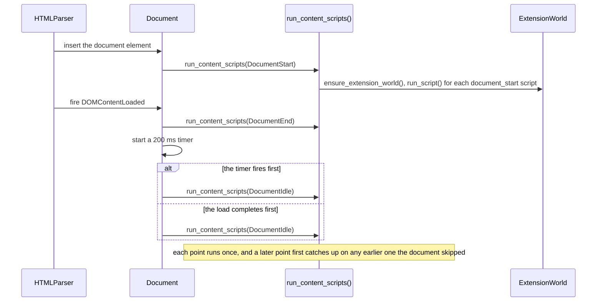
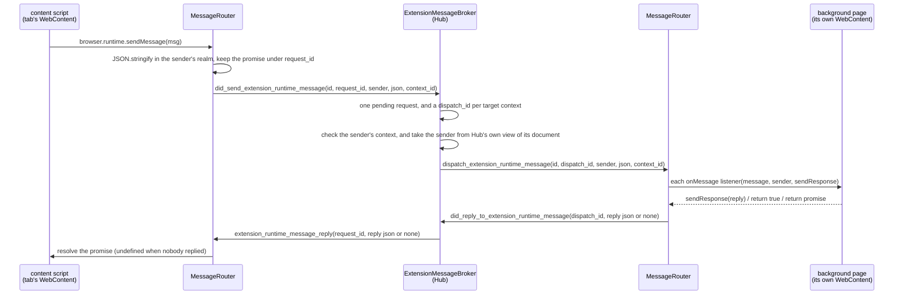

# Extensions support

Ladybird can load WebExtensions — the cross-browser extension model — from an unpacked directory, or from an .xpi or .zip archive. An extension’s content scripts run on the pages its manifest matches, in a JavaScript world of their own; its background scripts run in a hidden page of their own; and a content script talks to the extension’s own pages, its background page among them, through `browser.runtime.sendMessage()` and `browser.runtime.onMessage`.

The mechanism follows Ladybird’s process model: Hub reads extension directories, keeps the registry of installed extensions, serves their files, hosts their background pages, routes their messages, and decides what each one may do; RequestServer reports each request to the extensions that listen for it; and a WebContent process only ever sees a descriptor of each enabled extension, with the content-script sources already read for it.

This document is for two audiences. The first part is for people who want to use or write an extension; the rest is for maintainers reviewing or extending the implementation.

> [!NOTE]
> This covers content scripts, extension pages and resources, background and event pages, messaging, storage, the toolbar button and its popup, side panels, tabs and windows, script and CSS injection, webRequest (blocking included), webNavigation, and a few smaller APIs. _What isn’t there yet_ lists what’s missing, and _Architectural dependencies and design decisions_ answers some likely questions.

## Using extensions

### Loading an unpacked extension

Open `about:extensions` and choose Load Unpacked, then select the directory that holds `manifest.json`. The page asks for confirmation of the supported API permissions and host patterns declared by the extension. Add installs it; Cancel leaves the profile unchanged. If there are no permissions or host patterns to confirm, the extension is installed immediately.

Or pass the directory on the command line:

```sh
ladybird --load-extension /path/to/my-extension
```

The flag can be repeated. Each directory is loaded, assigned an id, and recorded in the profile’s `Extensions.json`, beside `Settings.json`, as its real, absolute path, so it loads again on every later start without the flag, whatever directory the browser starts in. A directory that’s already recorded — under any spelling of its path — keeps its id and whether it’s enabled when it’s loaded again, and is re-read from disk, which is how to pick up edits to the extension: Choose Reload on the page, or restart the browser.

Or choose Install from file... on `about:extensions` and select an `.xpi`, as Firefox’s add-ons site hands them out, or a `.zip` of an extension. The archive is unpacked into a staging directory and installed the same way, after the same confirmation, and its files then live in `extensions/<id>/package` in the profile, which Ladybird owns; removing the extension deletes that directory, while an unpacked extension’s directory stays the user’s. An archive whose manifest gives a Gecko id (`browser_specific_settings.gecko.id`, or the older `applications.gecko.id`) replaces the extension installed from an archive with that id, keeping its id, storage, grants, and persistent registered scripts. Nothing checks that the archive comes from the same author, so a replacement always asks first, naming the extension it takes over.

An extension that can’t be loaded isn’t installed; the error names the offending manifest key or the file that couldn’t be read:

```
Could not load the extension in /path/to/my-extension: manifest.json: "content_scripts" entries need a non-empty "matches" array
```

Installed extensions are enabled by default. `about:extensions` lists them in install order, with their localized name, version, description, directory, permissions, and state. Enable or disable them with the Enabled checkbox. Reload reads changes from disk. Remove asks for confirmation before deleting the extension from the profile and deleting its stored data; its source directory stays in place.

An installed extension that fails to load stays in the list with its error. A failed reload stops the loaded extension and revokes its contexts. Fix the files and choose Reload to try again, or Remove to forget it. These entries stay in `Extensions.json` across restarts.

### What an extension gets

An existing WebExtension works unchanged when it uses only the supported features:

- **Content scripts**, declared in the manifest’s `content_scripts`: JavaScript and CSS injected into every page that matches, at `document_start`, `document_end`, or `document_idle`, in all frames or just the top one, in the extension’s own isolated world or (with `"world": "MAIN"`) the page’s.
- **Extension pages and resources**, at `ladybird-extension://<id>/<path>`: an extension’s own pages load any of its files, and web pages load the ones its `web_accessible_resources` expose.
- **A background page** (manifest version 2 `background.scripts` or `background.page`, or manifest version 3 `background.service_worker`, which runs as a page script rather than as a worker), hosted in a hidden page of its own: for as long as the extension is enabled, for a version 2 page that doesn’t set `background.persistent` to `false`, and otherwise as an event page that unloads when it’s idle (see _Background page lifetime_).
- **The `browser` and `chrome` namespaces**, which are the same object, with `runtime.id`, `runtime.getURL()`, `runtime.getManifest()`, `runtime.sendMessage()`, `runtime.onMessage`, `runtime.connect()`, `runtime.onConnect`, `runtime.lastError`, `runtime.onInstalled`, `runtime.onStartup`, `runtime.onSuspend`, `runtime.onSuspendCanceled`, `runtime.openOptionsPage()`, `runtime.getPlatformInfo()`, and `runtime.setUninstallURL()`, which nothing visits.

- **Storage**, with the `storage` permission: `storage.local`, `storage.sync` (a file in the profile, with sync’s limits), `storage.session` (in memory), and an empty `storage.managed`, with change events shared by the extension’s contexts.
- **A side panel**, declared with the manifest’s `side_panel` (`default_path`) or `sidebar_action` (`default_panel`, `default_title`, `default_icon`): an extension page docked beside the web page, one per window, that stays across tab switches and navigations. The `sidePanel` namespace comes with the `sidePanel` permission (`setOptions`, `getOptions`, `setPanelBehavior`, `getPanelBehavior`, `open`, `close`, `getLayout`, `onOpened`, `onClosed`) and `sidebarAction` with the `sidebar_action` key (`setPanel`, `getPanel`, `setTitle`, `getTitle`, `setIcon`, `open`, `close`, `toggle`, `isOpen`); both drive the same panel. Opening it needs a user activation, as in the other browsers.
- **A toolbar button**, declared with `action` (manifest version 3) or `browser_action` (version 2): its icon, title, badge, and enabled state, set globally or for one tab through `browser.action` or `browser.browserAction`, and a popup page under the button that sizes itself to its content, from 25×25 up to 800×600. A click on a button without a popup fires `onClicked` in the background page. Right-clicking a button offers Manage extension, Hide, and Remove, and `about:extensions` has a Show in toolbar switch.
- **An options page**, declared with `options_ui.page` or `options_page`, which `runtime.openOptionsPage()` and the Options button on `about:extensions` open in a tab.
- **Tabs and windows**: see _The `tabs` API_.
- **Script and CSS injection** at run time: see _Script and CSS injection_.
- **Network and navigation events**: `webRequest`, blocking included, and `webNavigation`; see _webRequest and webNavigation_.
- **Smaller APIs**: `alarms`, `permissions`, `privacy`, `management.getSelf()`, `commands`, `contextMenus` (also `menus`), and `extension.isAllowedFileSchemeAccess()`; see _Other APIs_.

A minimal extension that does something visible:

```json
{
    "manifest_version": 3,
    "name": "Hello",
    "version": "1.0",
    "content_scripts": [{ "matches": ["<all_urls>"], "js": ["hello.js"], "css": ["hello.css"] }],
    "background": { "scripts": ["background.js"] }
}
```

```js
// hello.js, a content script: runs on every page, in its own world.
browser.runtime.sendMessage({ title: document.title }).then(reply => {
    console.log(`background said: ${reply}`);
});
```

```js
// background.js: runs once, in the extension's hidden background page.
browser.runtime.onMessage.addListener((message, sender, sendResponse) => {
    sendResponse(`hello from ${browser.runtime.id}, you sent ${message.title} from ${sender.url}`);
});
```

### Manifest keys

Both manifest versions are supported, and both will stay supported — an extension written against manifest version 2 won’t stop working. The parser reads these keys and ignores every other one:

| Key                                                                                                                  | Notes                                                                                                                                                                                    |
| -------------------------------------------------------------------------------------------------------------------- | ---------------------------------------------------------------------------------------------------------------------------------------------------------------------------------------- |
| `manifest_version`                                                                                                   | Required; 2 or 3.                                                                                                                                                                        |
| `name`, `version`                                                                                                    | Required.                                                                                                                                                                                |
| `description`, `default_locale`                                                                                      | `default_locale` names the fallback locale, and `description` is localized: see [Localization](#localization).                                                                           |
| `content_scripts[]`: `matches`, `exclude_matches`, `js`, `css`, `run_at`, `all_frames`, `match_about_blank`, `world` | `matches` is required and non-empty. `run_at` defaults to `document_idle`, `world` to `ISOLATED`.                                                                                        |
| `web_accessible_resources`                                                                                           | Version 2’s list of path globs (every page may load them), or version 3’s list of `{ "resources": [...], "matches": [...] }` objects.                                                    |
| `background`: `scripts`, `page`, `service_worker`, `type`, `persistent`                                              | `scripts` and `service_worker` are wrapped in a generated page; `page` is loaded as is; `"type": "module"` makes the generated script tags modules. `"persistent": false` makes a version 2 page an event page; version 3 ignores the key. |
| `action` (version 3), `browser_action` (version 2): `default_popup`, `default_title`, `default_icon`               | Each version reads only its own key. Icons are sorted by size, and every path is relative to the extension’s root. |
| `options_ui`: `page`; `options_page`                                                                                 | `options_ui.page` names the options page, or else `options_page` does. |
| `commands`                                                                                                           | Listed by `commands.getAll()`, each with its suggested shortcut for this platform; no shortcut is bound. |
| `browser_specific_settings` or `applications`: `gecko.id`                                                          | An archive with one replaces the extension installed from an archive with the same id. |
| `side_panel`: `default_path`; `sidebar_action`: `default_panel`, `default_title`, `default_icon`, `open_at_install` | One panel: with both keys, `side_panel`’s page is the panel and `sidebar_action`’s title and icon describe it. `open_at_install` is read and ignored: no panel opens by itself. |
| `content_security_policy`                                                                                            | Version 2’s policy string, or version 3’s object with an `extension_pages` entry. The default is `script-src 'self'; object-src 'self'`, which blocks inline scripts in extension pages. |
| `permissions`, `host_permissions`                                                                                    | Supported API permissions are `storage`, `unlimitedStorage`, `tabs`, `activeTab`, `alarms`, `scripting`, `contextMenus` and `menus`, `webRequest`, `webRequestBlocking`, `webNavigation`, `privacy`, and `sidePanel`; other names are ignored. Host patterns are parsed separately. |
| `optional_permissions`, `optional_host_permissions`                                                                  | What the extension may be granted later; version 2 mixes host patterns into `optional_permissions`. Each starts out ungranted. |

Match patterns follow the usual grammar: `<all_urls>`, or `<scheme>://<host><path>` where the scheme is `*` (http, https, ws, and wss), `http`, `https`, `ws`, `wss`, `file`, or `ftp`; the host is `*`, `*.` followed by a domain, or a domain (and ignored for `file`, so `file://*/*` is `file:///*`); and the path starts with `/` and may contain `*`. A host is parsed the way a URL’s host is, so a malformed one is an error, and an internationalized domain name or an IP address matches however a URL spells it. The path part is matched against the URL’s path plus its query string, and the port and fragment are ignored.

### Private windows

Extensions are off in private windows by default. Select Allow in private windows for the extension on `about:extensions` to opt in. Its background page remains in the normal profile, and its `storage.local` data is shared with normal windows. Changing this setting updates running processes immediately. The management page shows the same profile-wide list in normal and private windows.

### Permission grants

A first command-line installation grants the declared supported API permissions and saves them as `granted_permissions` in the extension’s record in `Extensions.json`. A reload keeps that grant set: Newly declared API permissions remain ungranted and are logged. A record without this key has no API grants. Load Unpacked on `about:extensions` shows the supported API permissions not already granted, together with the declared host patterns. Confirming adds those API permissions to the saved grants. Selecting an installed directory preserves its id, enabled state, and private-window setting. The Reload button keeps the saved grant set, just like a command-line reload.

Optional permissions start out ungranted. `permissions.request()` resolves with `false`, since there’s no prompt to grant them with yet, and `permissions.remove()` takes away a granted optional permission and persists that; either change applies without a reload. Clicking the toolbar button grants `activeTab` for that tab, when the manifest asks for it, until the tab navigates to another origin or closes. A declared content script’s `matches` count as host access, as `permissions.getAll()` reports; a content script registered at run time grants none.

### The `runtime` API

`browser.runtime.sendMessage(message)` serializes the message as JSON and returns a promise. The message goes to each of the extension’s own pages that’s open — its background page, and any other page at its `ladybird-extension://` URL — except the one sending it; a content script never receives a runtime message. The promise rejects with “Could not establish connection. Receiving end does not exist.” when no receiving context has a listener, including when its background page fails to start. Otherwise, it resolves with the first reply, or with `undefined` once every listener has declined, and a message that can’t be serialized (a function, a cycle) rejects it.

The extension’s own id may come before the message, and an options object after it (empty, or with an `includeTlsChannelId` boolean, which does nothing); the id of another extension is an error, since there’s no messaging between extensions. With a callback as the last argument, `sendMessage()` returns `undefined` and calls the callback with the reply instead, and when the call fails, `runtime.lastError` is an object with a `message` while that callback runs — and `undefined` at any other time.

`browser.runtime.onMessage.addListener(listener)` registers `listener(message, sender, sendResponse)`. `sender.id` is the extension’s id and `sender.url` the URL of the document the message came from. A listener answers in one of three ways, and the first answer from any listener wins:

- call `sendResponse(reply)` before returning;
- return `true`, and call `sendResponse(reply)` later;
- return a promise, whose settled value is the reply (a rejection is a decline).

Any other return value is ignored; the listener has declined. `removeListener()` and `hasListener()` work as elsewhere. A content script can’t message another content script; the extension’s own pages reach content scripts with `tabs.sendMessage()`.

`browser.runtime.getURL("images/icon.png")` returns `ladybird-extension://<id>/images/icon.png`, and `browser.runtime.getManifest()` returns a fresh parse of `manifest.json`.

The background page hears `runtime.onInstalled` with reason `"install"` the first time the extension loads, and with reason `"update"` and `previousVersion` when it loads with another manifest version; `runtime.onStartup` reaches each enabled extension’s background page when the browser starts. `runtime.getPlatformInfo()` reports this platform’s `os` and `arch`.

### Ports

`runtime.connect()` returns a Port synchronously. It accepts an optional extension id and an optional `connectInfo` object, whose `name` is a string: `connect()`, `connect({ name })`, `connect(extensionId)`, or `connect(extensionId, { name })`. A lone string is an extension id, not a port name. Omitting the id or using the extension’s own id connects to its other extension pages, including its background. Content-script worlds never receive these connections; `tabs.connect()` isn’t supported.

Each receiving page with a `runtime.onConnect` listener gets a Port. Ports expose `name`, `error` (initially `null`), `postMessage(message)`, `disconnect()`, `onMessage`, and `onDisconnect`; only receiver Ports expose `sender`, with the same `id` and `url` fields as runtime messages. An `onMessage` listener receives `(message, port)`, and an `onDisconnect` listener receives `(port)`.

Messages use JSON. A value that can’t be serialized throws a TypeError synchronously and sends nothing. Opener messages wait until every target’s synchronous `onConnect` listeners have finished; each opening queue allows 1,024 messages before the channel disconnects with “Port message queue is full”. Messages from one sender arrive in send order. The opener sends to every receiver, and each receiver sends only to the opener.

Calling `disconnect()` twice is harmless, and never fires the caller’s own `onDisconnect`. A receiver that disconnects or goes away leaves the opener connected while another receiver remains. Closing the opener notifies every receiver. Disabled, removed, or reloaded extensions lose all their channels. A disconnected Port never reconnects, and `postMessage()` on it throws “Attempting to use a disconnected port object”.

When no target accepts, or another extension’s id is supplied, the Port disconnects asynchronously with “Could not establish connection. Receiving end does not exist.”. Before listeners run, the Port is disconnected and `port.error` holds an Error; `runtime.lastError.message` holds the same message only during those listeners, restoring any enclosing error afterward. A clean disconnect leaves `port.error` null and doesn’t change `runtime.lastError`.

### The `storage.local` API

The `storage` permission exposes `browser.storage` and `chrome.storage`. Granting `unlimitedStorage` alone doesn’t expose the namespace. Content scripts and extension documents share one store per extension, and extensions can’t read each other’s items.

- `get()` and `get(null)` return every item. A string selects one key, an array selects those keys, and an object supplies default values for missing keys. Empty arrays and objects select nothing. A stored `null` remains distinct from a missing key.
- `set(object)` updates the supplied keys atomically. Values follow JSON serialization; cycles and other serialization failures reject the call before any request is sent. Keys such as `__proto__` are ordinary data properties.
- `remove(stringOrArray)` deletes selected keys atomically; missing keys have no effect. `clear()` removes every item.
- `getKeys()` returns every key, in insertion order.
- `getBytesInUse()` and `getBytesInUse(null)` report total usage. A string or array selects keys. Each key is counted once, using its UTF-8 bytes plus its serialized JSON value’s bytes.
- `QUOTA_BYTES` is 10,485,760. The granted `unlimitedStorage` permission lifts that limit. An over-quota update changes nothing.

Each method returns a promise. With a final callback, it returns `undefined` and calls the callback on completion. Failures call it with no arguments and expose `runtime.lastError.message` only while it runs; promise calls reject with an error instead.

`storage.onChanged` listeners receive `(changes, "local")`, and `storage.local.onChanged` listeners receive `(changes)`. Each changed key has `oldValue`, `newValue`, or both, according to whether it existed before and after the write. Unchanged writes emit no event. Committed changes reach every live context of the extension, including the writer, in write order.

Hub keeps `<profile data>/extensions/<id>/storage-local.json`, containing `{"formatVersion":1,"items":{...}}`. File IO runs on a worker. Each mutation replaces the file atomically before publishing its result. Write failures preserve the prior map; corrupt files and unsupported format versions report an error and remain in place for recovery. Temporary profiles keep the file under their temporary data directory.

Disabling an extension keeps its storage. Removing it through the registry first revokes its contexts, then queues deletion after outstanding writes. Deletion failures are logged. Editing an extension out of `Extensions.json` directly doesn’t run that removal operation. Private windows require the extension’s opt-in and share its normal-profile storage. The Remove confirmation on `about:extensions` explains that stored data will be deleted.

### Other storage areas

- `storage.sync` has the same calls as `storage.local`, kept in `storage-sync.json` beside `storage-local.json`; nothing syncs it anywhere. Sync’s limits apply, and `unlimitedStorage` doesn’t lift them: 102,400 bytes in all, 8,192 bytes for an item (its key and its value’s JSON), and 512 items. `MAX_WRITE_OPERATIONS_PER_HOUR` and `MAX_WRITE_OPERATIONS_PER_MINUTE` are there but aren’t enforced.
- `storage.session` has the same calls and quota as `storage.local`, held in Hub’s memory alone, so it’s gone when the extension is disabled, reloaded, or removed, and when the browser quits; `unlimitedStorage` doesn’t lift its quota. Only the extension’s own documents may use it, until the extension calls `setAccessLevel()` with `TRUSTED_AND_UNTRUSTED_CONTEXTS`.
- `storage.managed` is the area an administrator’s policy fills in, which nothing does in Ladybird: `get()` resolves with `{}`, `getKeys()` with `[]`, and `getBytesInUse()` with `0`, and `set()`, `remove()`, and `clear()` reject with “This is a read-only store.”

Each area’s changes reach `storage.onChanged` with the area’s name, and the area’s own `onChanged`.

### The `tabs` API

An extension’s own documents (its background page, popup, side panel, and its other pages) get `browser.tabs` and `browser.windows`; content scripts don’t, since they act on the page they’re in. No method needs a permission, except that the injection calls need host access too (see _Script and CSS injection_): Otherwise, the `tabs` permission, a host permission, or an `activeTab` grant decides only whether the extension sees a tab’s `url` and `title`.

- `tabs.query(queryInfo)` resolves with the browser’s tabs that match, in window order and then tab order. It filters on `active`, `highlighted`, `pinned`, `discarded`, `currentWindow`, `lastFocusedWindow`, `windowId` (`-2` is the current window), `index`, `status` (`"loading"`, `"complete"`, or `"unloaded"` for a restored tab that hasn’t loaded yet), `groupId`, `windowType`, `url` (a match pattern or a list of them), and `title` (with `*` and `?` wildcards). An unknown key or a wrongly typed value throws; `audible`, `muted`, `autoDiscardable`, `frozen`, and `splitViewId` aren’t supported yet, and reject.
- Each tab has `id`, `index`, `windowId`, `status`, `active`, `selected`, `highlighted`, `pinned`, `discarded`, `groupId` (always `-1`), and `incognito`. Its `url` and `title` are only there for an extension with the `tabs` permission, a host permission that matches the URL, or a tab showing one of the extension’s own pages — and a `url` or `title` filter never matches a tab whose URL or title the extension can’t see. A `url` pattern may name the extension scheme, to find the extension’s own pages.
- `tabs.sendMessage(tabId, message, options?)` reaches the extension’s content scripts in that tab, in every frame, or only in `options.frameId` (a negative one stands for every frame). Only the extension’s own documents can send one. Replies work as for `runtime.sendMessage()`, and a tab, frame, or content script that isn’t there rejects with the same no-receiver error. `documentId` isn’t supported, since nothing hands out document ids yet.
- A message or port from a document in a tab carries `sender.tab`, redacted the same way, and `sender.frameId`, which is `0` for the tab’s top-level document.
- `tabs.create()` and `tabs.update()` open and change a tab: its URL, whether it’s active or pinned, and for a new tab, its window and index. A call that names no window acts in the caller’s window (a popup’s is the one whose button opened it), or for a background page, in the window last focused. A relative URL resolves against the extension’s base URL, and a `javascript:` or `file:` URL or another extension’s page is rejected.
- `tabs.get()`, `tabs.remove()` (an id or a list, closing nothing unless every tab in it exists), and `tabs.reload()` (the caller’s active tab when the call names none, and `bypassCache` skips the cache). A tab closes on a later turn of the event loop, as when the user closes it, so its page’s `beforeunload` handler can ask first.
- `tabs.onActivated`, `tabs.onUpdated` (with what changed among the tab’s status, URL, title, and pin), and `tabs.onRemoved` (with `isWindowClosing`), redacted as `tabs.query()` is.
- In manifest version 2, `tabs.executeScript()`, `tabs.insertCSS()`, and `tabs.removeCSS()`: see _Script and CSS injection_.
- `windows.get()`, `getAll()`, `getCurrent()`, and `getLastFocused()`, each window with its type, whether it’s private, and with `populate`, its tabs. `windows.onFocusChanged` fires as focus moves among the browser’s windows, with `WINDOW_ID_NONE` when it leaves them all. Nothing reports a window’s size or position, and `windows.onCreated` and `onRemoved` never fire.

Tab and window ids are positive integers that last while the browser runs: A tab keeps its id across navigations, process swaps, and moves to another window, and no id is reused. The current window is the one holding the tab an extension page is in; for the background page, it’s the window the user last used among those the extension can see. A tab of a private window exists for an extension only if it’s allowed in private windows. Background pages and other hidden views are never tabs.

### Script and CSS injection

- In manifest version 3, with the `scripting` permission: `scripting.executeScript()` runs files of the extension, or a function with JSON arguments, in a tab’s top frame, in the frames it names, or in all of them, in the extension’s world or the page’s. It waits for each document to be idle unless the call asks to inject immediately, and resolves with each frame’s result, the top frame’s first. A function travels as its source, so it can’t see what it closed over. `scripting.insertCSS()` and `removeCSS()` add and take away CSS or files as author or user style sheets. And `registerContentScripts()`, `getRegisteredContentScripts()`, `updateContentScripts()`, and `unregisterContentScripts()` manage content scripts at run time; those with `persistAcrossSessions` (the default) are kept in the extension’s `registered-content-scripts.json` in the profile.
- In manifest version 2: `tabs.executeScript()`, `tabs.insertCSS()`, and `tabs.removeCSS()` act on a tab’s top frame, or on the frame `frameId` names (with `allFrames`, its whole subtree), and honor `runAt` and `matchAboutBlank`. `contentScripts.register()` registers a content script from an extension page, with include and exclude globs, `matchOriginAsFallback`, and a world; a registration lasts as long as the page that made it, and none is kept across a restart.

Hub picks the frames, from every process the tab spans, and refuses a frame the extension can’t reach: a browser page, another extension’s page, or a host it has neither a host permission nor an `activeTab` grant for. A content script registered at run time runs only where the extension already has host access.

### webRequest and webNavigation

With the `webRequest` permission, an extension’s own pages get `browser.webRequest` and its nine events: `onBeforeRequest`, `onBeforeSendHeaders`, `onSendHeaders`, `onHeadersReceived`, then `onBeforeRedirect`, or `onResponseStarted` and `onCompleted`, and `onErrorOccurred` for a failure. `onAuthRequired` takes listeners, but nothing fires it yet. A listener hears a request only when the extension has host access to the request’s URL and to the document that made it, and never hears a request of an extension’s own pages or of the browser itself. A page’s WebSocket handshakes and a worker’s requests are reported too.

With `webRequestBlocking` as well, a listener added with `"blocking"` can cancel a request, change its request or response headers, or at `onBeforeRequest`, redirect it: to an HTTP(S) URL, a `data:` URL, or one of the extension’s web-accessible resources. Any cancel wins; otherwise the most recently installed extension’s answer counts. A canceled request fails with a network error that `onErrorOccurred` names `NS_ERROR_ABORT`. While an extension that may block is starting, a page’s requests wait for its background page to load, for at most 10 seconds, so that none slips past its listeners.

With the `webNavigation` permission, an extension’s own pages get `browser.webNavigation`: `onBeforeNavigate`, `onCommitted`, `onDOMContentLoaded`, `onCompleted`, `onErrorOccurred`, `onHistoryStateUpdated`, `onReferenceFragmentUpdated`, and `onCreatedNavigationTarget`, each with optional URL filters, and `getAllFrames()` and `getFrame()`.

### Other APIs

| Namespace | Needs | What’s there |
| --- | --- | --- |
| `alarms` | `alarms` | `create()`, `get()`, `getAll()`, `clear()`, `clearAll()`, and `onAlarm`, which wakes an event page that listens. At most 500 alarms, none due sooner or repeating more often than once a second, and none kept across a restart. |
| `permissions` | Nothing | `getAll()`, `contains()`, `remove()`, `onAdded`, and `onRemoved`; `request()` resolves with `false`, since there’s no prompt yet. |
| `privacy` | `privacy` | `network.networkPredictionEnabled` (off stops DNS prefetching and preconnecting for every page), `network.peerConnectionEnabled`, `network.webRTCIPHandlingPolicy`, and `websites.hyperlinkAuditingEnabled`, which always reads `false`. The settings other than network prediction report what was set and change nothing. The most recently installed extension that sets a value decides it. |
| `management` | Nothing | `getSelf()` alone. Its `installType` is `"normal"` for an extension installed from an archive and `"development"` for one loaded from a directory. |
| `contextMenus`, `menus` | `contextMenus` or `menus` | Every call works, but nothing shows the items yet, so `onClicked` never fires. |
| `commands` | Nothing | `getAll()` and `update()`; no shortcut is bound, so `onCommand` never fires. |
| `extension` | Nothing | `isAllowedFileSchemeAccess()`, which resolves with `true`, since host permissions alone gate file access. |

Content scripts get none of these: A content script has `runtime`, `i18n`, and with the `storage` permission, `storage`.

### Background page lifetime

A manifest version 2 background page is persistent unless `background.persistent` is `false`: It runs for as long as its extension is enabled. Any other background page — a version 2 event page, or any version 3 page — starts once when its extension is enabled or the browser starts, so it can register its listeners, and then unloads after 30 seconds with nothing to do. A runtime message, a port, a `storage.local` change, or an API event it listened to on its last run (an alarm, a tab event, `action.onClicked`, e.g.) starts it again, and waits for it to load; the page’s globals are gone by then.

Any message, reply, port message, or storage request for the extension counts as activity. A message to the page that hasn’t been answered keeps it loaded (on version 3, for at most five minutes), and so does an open port to a version 2 event page; on version 3, an idle open port doesn’t. A persistent page whose process crashes starts again at once; any other starts again when something next needs it.

Before a page unloads, its `runtime.onSuspend` listeners run, and it unloads once they have, or after a second — work they start gets no more time than that. A message or port that arrives meanwhile keeps the page, and its `runtime.onSuspendCanceled` listeners run instead. What the page does itself while suspending (a `storage.local` write, e.g.) doesn’t keep it, and a storage change the page made itself doesn’t wake it again.

### What isn’t there yet

- No `declarativeNetRequest`, `cookies`, `offscreen`, `dns`, or `webRequest.filterResponseData()`, and no `tabs.connect()`.
- A manifest version 3 `service_worker` runs as a script of the generated background page, not as a worker, so `self` is the window rather than a worker’s global, `importScripts()` and the other worker-only APIs aren’t there, and `window` and `document` are. An extension that only uses the extension APIs won’t notice.
- `permissions.request()` has no prompt and resolves with `false`; context-menu items and command shortcuts are accepted but never shown or bound; and `action.setIcon()` takes paths, but not image data.
- No messaging between extensions, and no native messaging.
- Alarms, `storage.session`, toolbar-button state, context-menu items, and privacy settings last only until the browser quits.
- Nothing checks who made an archive, and nothing updates an installed extension automatically; installing a newer archive with the same Gecko id replaces it.
- `windows` reports no size or position, and `windows.onCreated` and `onRemoved` never fire.

## Key concepts

### Manifest versions 2 and 3

Both exist in the wild and differ mostly in shape: version 2 lists `web_accessible_resources` as bare paths, mixes host patterns into `permissions`, holds `content_security_policy` as a string, and runs background scripts in a page; version 3 pairs web-accessible resources with the pages that may load them, splits `host_permissions` out, nests the policy under `extension_pages`, and runs a background service worker. Ladybird parses both into one model (`ExtensionManifest`), and will keep doing so.

### Content scripts, worlds, and the extension URL scheme

A **content script** is extension code that runs inside a web page. It sees the page’s live DOM but not the page’s JavaScript objects: it runs in an **isolated world**, a separate JavaScript realm whose global is a different wrapper of the same `Window`. An expando the page sets on `window` or on an element isn’t visible to the content script, and vice versa, so neither side can tamper with the other’s prototypes. A script that opts into `"world": "MAIN"` runs as one of the page’s own scripts instead, with no `browser` namespace.

Each extension gets an **id** when it’s installed: a UUID private to the profile. Its pages and files are addressed as `ladybird-extension://<id>/<path>`, and each extension’s URLs form one origin, distinct from every web origin and from every other extension. A page can’t tell which extensions are installed by probing those URLs, since it can’t guess the ids.

### Background page and messaging

An extension’s **background page** is where its long-lived logic runs: a hidden document at the extension’s own origin, with the `browser` namespace in its main realm, started when the extension is enabled. A content script sends **runtime messages** to the background page and the extension’s other pages, which answer them, each message a JSON value, routed through Hub because every page may live in a different WebContent process.

## Architecture



Hub here is the process that runs LibWebView’s `Application`: `ladybird-hub` under the Qt UI, and the browser’s own process in a headless run or under test-web (see [ProcessArchitecture.md](ProcessArchitecture.md)). The Qt UI only shows what Hub asks it to: toolbar buttons, popups, side panels, and the pickers `about:extensions` opens. Popups and side panels have hosts in Hub of their own, `ExtensionPopupHost` and `ExtensionSidePanelHost`, beside the background host.

The split follows one rule: **the extension directory is read only in Hub.** A WebContent process is sandboxed and can’t read arbitrary files, so Hub reads every content script and style sheet at load time and ships the source text inside the descriptor, and serves every other extension file on request, after checking that the requesting page may have it.

The three kinds of state, and who owns them:

| State                                                                | Where                                                                                | Lifetime                                                                                                          |
| -------------------------------------------------------------------- | ------------------------------------------------------------------------------------ | ----------------------------------------------------------------------------------------------------------------- |
| Installed extensions (id, directory, enabled, grants)                | `Extensions.json` in the profile, beside `Settings.json`; `ExtensionRegistry` holds the loaded objects | The profile                                                                                                       |
| Enabled extensions’ descriptors                                      | `ExtensionSet::the()` in each WebContent process                                     | Replaced wholesale on every `set_extensions`                                                                      |
| Persistent registered content scripts, `storage.local`, `storage.sync` | `registered-content-scripts.json`, `storage-local.json`, and `storage-sync.json` in `extensions/<id>/` in the profile | Until unregistered or cleared, or the extension is removed |
| Alarms, `storage.session`, toolbar-button state, context-menu items, privacy settings | Hub’s memory | Until the browser quits, or the extension is disabled, reloaded, or removed |
| Per-document extension state (worlds, run_at progress, injected CSS) | `DOM::Document`                                                                      | The document; worlds are detached when the document is destroyed, or when their extension is reloaded or disabled |

## Loading an extension



`ExtensionRegistry::load_unpacked()` resolves the directory to its real path, then gives a new directory a fresh UUID and records it in `Extensions.json`; a directory already recorded, under any spelling, keeps its id. The list lives in a file of its own so that a build without extension support, which writes `Settings.json` whole, can’t drop it; a list an older build left in `Settings.json` is moved over once. `restore_from_settings()` runs at startup (skipped in test mode, so tests never depend on the user’s installed extensions) and keeps any entry whose directory no longer loads, together with its load error. Each load, and each change to whether an extension is enabled, gives it a new revision, so every process can tell the new instance from the one it replaced. Every change notifies `ExtensionRegistryObserver::extensions_changed()`. The application observer drops the messaging contexts of a revision that’s gone, pushes the enabled descriptors to every live WebContent process, and resyncs the background host. A WebContent process that starts later gets the descriptors as part of its launch. Management-page observers send a fresh snapshot after each change.

`prepare_unpacked()` reads the extension and reports newly declared supported permissions without changing the profile. `install()` applies the confirmed grants and replaces the loaded instance. The page keeps one pending install behind a token, discards it on cancellation or a registry change, and accepts directories only from the browser-owned picker. Opening that picker, confirming installation, and confirming removal consume the page’s transient user activation.

The background host can’t create a view inside `Application::initialize()` — a view needs the event loop and the session the browser’s own first view sets up — so its first sync is deferred to the loop’s first turn. And since a view’s destructor reaches back into the Application, the host is destroyed first in `~Application()`.

## The `ladybird-extension://` scheme

`ladybird-extension://<id>/<path>` is a fetch scheme (it’s in `FETCH_SCHEMES`, so navigations to it reach our loader instead of being handed to an external handler), a secure context, and a tuple origin: `URL::URL::origin()` returns `("ladybird-extension", <id>, null port)`, so two documents of one extension are same-origin with each other and with nothing else.

Loads go through `ResourceLoader::handle_extension_load_request()`. The generated background page is served from the descriptor itself; any other path is requested from Hub. There, `canonical_resource_path()` decodes the path the same way for the access check and for the file it opens, refusing an encoded `/`, a backslash, a NUL, an empty segment, and any `..` above the root. `Extension::open_resource()` then opens it relative to a handle on the extension’s directory, requires a regular file, and checks that the opened file’s real location is inside that directory, so no symlink can lead out of it. The manifest, script, and CSS reads at load time go through the same opener. The file descriptor goes back through the same `handle_file_return` path that `file://` loads use. Every response carries:

| Header                         | Value                                                 |
| ------------------------------ | ----------------------------------------------------- |
| `Content-Type`                 | Guessed from the file name                            |
| `Content-Security-Policy`      | The manifest’s extension-pages policy, or the default |
| `Access-Control-Allow-Origin`  | `*`                                                   |
| `Cross-Origin-Resource-Policy` | `cross-origin`                                        |

### Who may load what

The decision is made in `Fetching.cpp`, at the point where a fetch hands off to the loader (`extension_resource_load_is_allowed()`), so navigations, subresource loads, and `fetch()` calls all go through it. Hub checks every request again before it opens a file (see _Security model_):



So an extension’s own pages load anything of it; the browser itself (a URL typed in the address bar, or the background host) may navigate to any of its pages; and a web page gets only what the manifest exposes to that page’s URL. The CORS gate in `main_fetch` exempts the scheme because this check decides access, and the `Access-Control-Allow-Origin: *` header then lets a cross-origin `fetch()` of an exposed resource read the body.

### Requests an extension makes

An extension’s own page (its background page, popup, side panel, or options page) reads the response of a request to any URL the extension has host access to, whatever CORS headers the server sends, and such a request is never preflighted. It still goes out as a cross-origin request, with the extension’s origin in `Origin` and no cookies under the default credentials mode, and each redirect is judged again. A content script’s requests have the page’s origin, so they keep ordinary CORS. The page’s CSP, though, doesn’t apply to them, nor to any request for an extension’s own URL: Which pages may load an extension’s resource is the web-accessible list’s decision.

## Content-script injection

Three `run_at` points, each reached once per document, hooked where the document reaches that state:

| `run_at`         | When                                                                                                     | Hook                                                                                         |
| ---------------- | -------------------------------------------------------------------------------------------------------- | -------------------------------------------------------------------------------------------- |
| `document_start` | The document element has just been inserted; nothing else has been parsed                                | `Document::children_changed()`                                                               |
| `document_end`   | Right after `DOMContentLoaded` fires                                                                     | `HTMLParser::the_end()`, which then arms the idle timer                                      |
| `document_idle`  | 200 ms after `DOMContentLoaded`, or when the document completely finishes loading, whichever comes first | `Document::schedule_content_script_idle_point()` and `Document::completely_finish_loading()` |



`run_content_scripts(document, up_to)` walks the points in order up to the one requested, skipping the ones already run, so a document that reaches a later state without having passed through an earlier hook still gets its earlier scripts: an `about:blank` document has no parser to fire `DOMContentLoaded`, so its `document_end` scripts run at idle; and a navigable’s initial `about:blank`, which gets its document element before it’s fully active, gets its scripts from the end of `LocalNavigable::initialize_navigable()` at whatever point it has reached.

For each enabled extension and each of its content scripts, `content_script_matches()` decides: a script without `all_frames` runs only in the top-level document; `exclude_matches` is checked before `matches`; and only when the script sets `match_about_blank`, an `about:blank` or `about:srcdoc` document is matched by the URL of its nearest same-origin parent or opener that isn’t one (`Document::url_for_extension_matching()`) — never by its base URL, which the page can set. Each CSS file becomes a style sheet of its own at author origin, parsed with its `ladybird-extension://` URL as its base, so its relative URLs and `@namespace` rules are its own. The sheets keep manifest order and come before the page’s own sheets in the cascade, so the page wins a tie, and they never show up in `document.styleSheets`. A script may navigate or destroy the document; nothing more runs in a document that’s no longer fully active, and the idle timer is stopped in `Document::destroy()`.

Content scripts registered at run time (`scripting.registerContentScripts()`, `contentScripts.register()`) follow the manifest’s own in the descriptor, and reach the page processes alone when they change (`set_registered_content_scripts()`), rather than with every enabled extension’s descriptor. They may carry include and exclude globs, matched against the whole serialized URL, and may match an `about:`, `data:`, or `blob:` document by its creator’s origin (`matchOriginAsFallback`). A registration made from `webNavigation.onBeforeNavigate` while a blocking `onBeforeRequest` listener holds the page’s request reaches the page’s process before the request goes on, so its scripts run at `document_start` of the document that request loads.

## Extension worlds

An `ExtensionWorld` is one extension’s realm in one document, created the first time one of its isolated-world scripts runs there (`Document::ensure_extension_world()`), and kept in the document’s map by extension id. It’s built on the wrapper architecture described in [WrapperArchitecture.md](WrapperArchitecture.md): a `WrapperWorld` of type `Extension`, a realm whose global object is that world’s wrapper of the document’s own `Window` (and whose global `this` is that world’s `WindowProxy` for the browsing context), its own `Intrinsics`, and a `HostDefined` that names the document’s principal realm. `initialize_window_web_interfaces()` then gives the realm the full set of Web IDL interfaces, so a content script sees the same DOM the page does, through wrappers the page never touches. The world’s global also carries `wrappedJSObject`, the page’s own `Window`, so a content script can read the globals the page’s scripts set, as a Firefox content script does through the same name; the page’s realm has no such property.

The scripts themselves are parsed in the world’s realm (`ClassicScript::create_in_realm()`), with an environment settings object of the world’s own, `ExtensionWorldEnvironmentSettingsObject`: the document’s environment in every respect but the realm, which is the world’s. So a content script’s globals, prototypes, wrapper cache, and module map are its own: A module it imports from its extension is parsed in the world’s realm, with the namespace. A request it makes (`fetch()`, `XMLHttpRequest`, `WebSocket`, `EventSource`) has the world’s settings object as its client, so the page’s CSP doesn’t apply to it, while an element it adds to the page is the document’s and keeps the page’s policy. Its uncaught errors are its own too: A classic script reports them to the global of the realm it was parsed in, and the `ErrorEvent` reaches only that world’s listeners. A `MAIN`-world script skips all of that and runs through `ClassicScript::create()` like one of the page’s own scripts.

`Document::destroy()` detaches every world before the document goes away: the realm and its wrapper cache are dropped, the world is unregistered from the `MessageRouter`, and any later `sendMessage()` through a namespace the script kept a reference to fails. A world is also detached once its extension is reloaded, disabled, or removed (the `MessageRouter` detaches every context whose descriptor the new extension set no longer holds), and the extension’s next script in that document gets a new world. Nothing of a detached world runs again: Its API functions fail or do nothing, and its event listeners, callbacks, promise jobs, and timers are skipped. What its scripts already did to the page stays, CSS included, and an already-loaded page doesn’t get the scripts of a reloaded or re-enabled extension until it navigates.

An object-valued `CustomEvent.detail`, `ErrorEvent.error`, `MessageEvent.data`, `PopStateEvent.state`, or `History.state` read from the world that made it is that object itself. Read from another world, it’s a structured clone made in the reader’s realm — or `null`, for a value that can’t be cloned — so an event never hands one world’s objects to another. The generated getters of the attributes marked `[CloneAcrossWorlds]` do that, so the implementation getters never see a realm.

## The `browser` namespace

`install_namespace()` defines `browser` and `chrome`, one object, on a realm’s global: in an `ExtensionWorld` for content scripts, and in the principal realm of any document at a loaded extension’s own URL (`ExtensionDocumentContext`, created in `Document::make_active()` before any of the document’s scripts run). Both kinds of context implement `MessagingContext`, the interface the router talks to: a realm, a descriptor, a listener list, the page, a `MessageSender` describing it, and whether it’s been detached.

The namespace is plain JavaScript objects and native functions built in `Extensions/API/`, not Web IDL interfaces: `Runtime.cpp` builds `runtime`, and `Event.cpp` builds an event object (`addListener`, `removeListener`, `hasListener`) over an `EventListenerList` GC cell the context owns. A content script gets `runtime`, `i18n`, and with the `storage` permission, `storage`; every other namespace is for the extension’s own documents alone, each only with its permission or manifest key (`install_namespace()` decides).

A call that Hub answers goes through one message, `did_call_extension_api(method, arguments_json)`, answered through `extension_runtime_message_reply()`, and Hub calls a context’s listeners for a named event with `dispatch_extension_event()`. A context tells Hub which of its named events have listeners whenever one gains its first or loses its last (`did_change_extension_event_listeners()`), so an unloaded event page wakes only for an event it listens to.

## Runtime messaging



Within a process, `MessageRouter::the()` keeps the live contexts, each with an id of its own. `send()` serializes the message in the sender’s realm, fails the call when that fails, and hands the JSON to the page client, keeping the promise or callback under the sending context. `dispatch()` runs the `onMessage` listeners of the one context the message is addressed to, with a `ReplyCollector` that counts the listeners before any runs (so an early reply can’t finish the count under a later one) and calls exactly the ones it counted. It takes the first answer, and reports an empty reply once every listener has declined. `sendResponse` answers once; a later call, or one after the context is gone, does nothing. And a context that goes away drops its pending calls and declines any answer it still owed.

In Hub, `ExtensionMessageBroker` keeps each context a page (an `Endpoint`) registers through `did_create_extension_context`, with its document’s id and the extension’s revision. It accepts a context only if the page hosts that document, the revision is current, and the document is either one of the extension’s own pages or one its content scripts match. The sender a receiver sees comes from that document’s URL as Hub knows it, and the background flag from whether the page is the extension’s background view. A send goes to every context of the extension’s own pages except the sender’s — never to a content script — each under its own dispatch id. The first reply settles the sender’s request, and later ones are dropped; a reply counts only from the page its dispatch went to; and when every target has declined, or gone away (`endpoint_gone()` runs from `~WebContentPage()`), the sender learns that nobody replied. With no target at all, the sender gets that answer at once, unless the extension’s background page is still starting (see below).

Messages are JSON rather than structured clones, so a `Date` or a `Map` doesn’t survive the trip; that matches what extensions already expect from `sendMessage`.

## Background pages

`ExtensionBackgroundHost::sync()` keeps one hidden `HeadlessWebView` per enabled extension whose descriptor `has_background`, starting and stopping views as the registry changes, and replacing a view once its extension has a new revision. The view loads `ladybird-extension://<id>/_generated_background_page.html` — served from the descriptor’s `background_document_html`, a page of `<script src>` tags for `background.scripts` or the `service_worker`, with `type="module"` when the manifest says so — or the manifest’s own `background.page`. A background page whose WebContent process crashes is reloaded.

From the moment a background is due to start (`prepare()` runs before any descriptor goes out), the broker holds the messages sent to its extension, and delivers them once the page has loaded and its scripts have run. A failed load, a crash, a disable, a replacement, or 30 seconds without a finished load rejects them with the receiving-end error; after a crash, the page reloads, and new messages wait for it again.

Because the background page is an ordinary document at the extension’s origin, it gets its namespace through the same `ExtensionDocumentContext` that any extension page does. Hub marks its messages as the background page’s when they come from the page in the extension’s background view — the manifest’s own `background.page` included — rather than by its path. It’s a full page in its own process, so it can use `fetch()`, timers, and the DOM, and it runs for as long as _Background page lifetime_ says: a persistent page for as long as the extension is enabled, and an event page while it has work.

## IPC endpoints

| Endpoint                                                                                                                                                     | Direction        | Purpose                                                                                       |
| ------------------------------------------------------------------------------------------------------------------------------------------------------------ | ---------------- | --------------------------------------------------------------------------------------------- |
| `set_extensions(extensions)`                                                                                                                                 | Hub —> WebContent | Replace the process’s `ExtensionSet` with the enabled descriptors                             |
| `dispatch_extension_runtime_message(page_id, extension_id, dispatch_id, sender, message_json, context_id)`                                                   | Hub —> WebContent | Deliver a runtime message to one context of the extension on the page                         |
| `extension_runtime_message_reply(page_id, request_id, reply_json)`                                                                                           | Hub —> WebContent | Settle a `sendMessage()` promise the page is waiting on                                       |
| `did_request_extension_resource(page_id, extension_id, path, request_id)`                                                                                    | WebContent —> Hub| Ask for a file of the extension; answered through `handle_file_return(error, fd, request_id)` |
| `did_create_extension_context(page_id, extension_id, context_id, document_id, revision)`, `did_destroy_extension_context(page_id, extension_id, context_id)` | WebContent —> Hub| Register a context, with its document and the extension’s revision, or remove one             |
| `did_send_extension_runtime_message(page_id, extension_id, request_id, sender, message_json, context_id)`                                                    | WebContent —> Hub| A `sendMessage()` to route                                                                    |
| `did_reply_to_extension_runtime_message(page_id, dispatch_id, reply_json)`                                                                                   | WebContent —> Hub| The page’s answer (or decline) to one dispatch                                                |

The IPC-encodable types live in `LibWebCommon/Extensions/`, which both sides link: `ExtensionDescriptor` (with `ContentScriptDescriptor` and `WebAccessibleResourceDescriptor`), `MatchPattern`, `MessageSender`, and the scheme constants in `Scheme.h`.

Storage transport adds `did_request_extension_storage(page_id, context_id, request_id, request)` from WebContent to Hub, plus `extension_storage_reply(page_id, request_id, result)` and `dispatch_extension_storage_changed(page_id, extension_id, changes_json)` in the other direction.

The `tabs` API adds `did_request_extension_tabs_query(page_id, context_id, request_id, query_json)` and `did_send_extension_tab_message(page_id, extension_id, request_id, context_id, tab_id, frame_id, message_json)` from WebContent to Hub; both are answered through `extension_runtime_message_reply()`.

Later APIs add these from WebContent to Hub: `did_call_extension_api()` for every API call Hub answers; `extension_runtime_connect()`, `extension_runtime_connect_ack()`, `extension_port_post_message()`, and `extension_port_disconnect()` for ports; `did_change_extension_event_listeners()`; `did_finish_extension_suspend()`; `did_execute_extension_injection()`; and `did_change_extension_web_request_listeners()` and `did_answer_extension_web_request_event()`. And from Hub to WebContent: `set_registered_content_scripts()`, `dispatch_extension_event()`, `dispatch_extension_suspend()`, `execute_extension_injection()`, `dispatch_extension_web_request_event()`, and the ports’ `dispatch_extension_runtime_connect()`, `extension_runtime_connect_result()`, `dispatch_extension_port_message()`, and `dispatch_extension_port_disconnect()`.

Between Hub and each RequestServer: `set_web_request_interest()` sends every listener’s filter, so RequestServer reports only the requests some listener wants; `web_request_event()` reports an event of such a request, and when a blocking listener hears it, holds the request until `web_request_decision()`; `set_web_request_startup_gate()` holds a page’s requests while the extensions that may block them start; and `set_network_prediction_enabled()` carries the privacy setting. A request carries its webRequest context in `start_request()` and `websocket_connect()`, and `request_redirected_by_extension()` tells the page’s process that a redirect came from an extension.

## Security model

- **A WebContent process never reads the extension directory.** It receives script sources in the descriptor and asks Hub for everything else by id and path. Hub opens the file through a handle on the extension’s directory, and refuses anything outside it, symlinks included.
- **Web pages get only web-accessible resources**, judged by the manifest and the requesting document’s URL (never its base URL), at one place in fetch. Everything else is a network error, which looks to the page like the resource doesn’t exist. Hub checks again before it opens a file: The extension has to be enabled, and the requesting WebContent process has to host a document that may load the resource.
- **Extension ids are per-profile UUIDs**, so a page can’t probe for installed extensions at a URL that’s the same everywhere. An id isn’t a secret, though — a content script can reveal it — so every request is still checked.
- **Content scripts can’t be reached by the page.** Their realm, prototypes, and wrapper cache are separate; only the DOM is shared, an object an event carries from one world to another arrives as a clone, a content script’s uncaught errors stay in its world, and the page’s CSP doesn’t apply to them, nor to the requests they make.
- **Extension pages get a CSP** of `script-src 'self'; object-src 'self'` unless the manifest sets one, so an extension page can’t run inline or remote script.
- **Storage requests require the granted `storage` permission.** Hub resolves each request against its registered page, document, and extension revision. It derives the extension id from that record and drops unknown or stale contexts. Renderers never open the storage file.

- **An extension’s documents get processes of their own.** A process that has hosted an extension’s own documents hosts only that extension’s documents and `about:blank` documents nothing else can reach, so a website that an extension’s page opens or embeds runs elsewhere, and so does another extension (`CanonicalNavigable::process_to_host()`, as for a WebUI’s documents).
- **Hub decides what an extension may do.** Its grants, the sender and tab of every message, which tabs, URLs, and titles it sees, which frames an injection reaches, and whether a webRequest listener may block are all decided in Hub, from its own record of each page’s documents, never from what a renderer claims. A frame’s injection result counts only from the page Hub sent the injection to.
- **webRequest sees only what host access covers.** A listener hears a request only with host access to its URL and to the document that made it, never an extension’s own requests or the browser’s, and blocks only for an extension Hub knows holds `webRequestBlocking`. Fetch follows a redirect to a `data:` or extension URL only when RequestServer reports that an extension asked for it; a server sending the same `Location` gets a network error.
- **An extension page reads cross-origin responses only where it has host access**, and the request still goes out cross-origin, without cookies by default. A content script’s requests keep ordinary CORS.
- **An archive can’t write outside its directory, and its size is bounded.** The extractor refuses absolute names, `..` and empty parts, backslashes and drive letters, symbolic links, names that differ only in case, an entry over 64 MiB, more than 10,000 entries, more than 256 MiB in all, and an archive over 320 MiB, and leaves nothing behind when it does.

Known gaps: Hub can’t yet tell which document of a WebContent process asked for a resource, so every document of a process that hosts one allowed document gets the same answer; site isolation limits those to the documents of one site. It checks that a context’s document exists and that the extension’s content scripts match it, but it can’t prove that a script of that extension runs there. And on a platform with neither `F_GETPATH`, `/proc/self/fd`, nor `GetFinalPathNameByHandleW()`, every extension file read fails, rather than going unchecked.

## Architectural dependencies and design decisions

This section answers some likely questions: what extensions depend on elsewhere in Ladybird, which choices were deliberate, and what the implementation doesn’t do, by design or not yet.

### Doesn’t a content script need wrappers of its own?

It has them. Content-script isolation is built on the wrapper architecture in [WrapperArchitecture.md](WrapperArchitecture.md), which gives each implementation object one wrapper per `WrapperWorld`, and which has a world type for extensions, `WrapperWorldType::Extension`. An extension world is such a world: its own realm, intrinsics, prototypes, wrapper cache, environment settings object, and module map, over the document’s own DOM. Nothing here adds a second wrapper mechanism. What it adds around that architecture is narrow: `[CloneAcrossWorlds]` on the five attributes that hand one script’s object to another’s listeners, an error event’s restriction to its world, skipping a detached world’s callbacks, jobs, and timers, and a settings object of the world’s own wherever a realm’s settings object is looked up.

It isn’t a membrane that filters the page’s objects. A content script sees the DOM through its own wrappers, and sees what the page’s scripts defined only through `wrappedJSObject`, which hands it the page’s own `Window`, unfiltered. A content script that uses it gets whatever the page did to its globals, which is what the extensions that read it expect.

### Is this safe for a renderer a page has taken over?

The protection comes from Ladybird’s process model and from Hub’s checks, and from nothing else. An extension’s privileges stay out of web pages’ processes in two ways. First, nothing privileged is in a renderer at all: Files, storage files, grants, tab and window state, and every decision about what an extension may do stay in Hub, which checks each context a renderer reports against its own record of that page’s documents. Second, an extension’s documents get processes of their own: `CanonicalNavigable::process_to_host()` keeps a process that has hosted an extension’s own documents to that extension’s documents and the `about:blank` documents nothing else can reach, and sends that extension’s documents to no other process, as it does for a WebUI’s documents. The one exception is a process that has hosted only `about:blank` documents, which holds nothing a site made: That’s the process a view the browser makes for an extension starts in, so its first page stays there. So a website that an extension’s page opens or embeds runs elsewhere, and so does another extension. Background pages, popups, and side panels are each a view of their own.

So there’s no extension process with privileges of its own to protect: An extension’s documents are ordinary documents in ordinary sandboxed WebContent processes. What a renderer that a page has taken over can do is act as the extension contexts it already hosts, i.e. as the content scripts the extensions run in that page. Those get only `runtime`, `i18n`, and `storage`; everything else (`tabs`, `scripting`, `webRequest`, and the rest) belongs to the extension’s own documents.

With isolation turned off (`--debug-process ladybird-render`), every document stays in the process of its navigable, an extension’s documents included, as a WebUI’s do.

### Why implement blocking webRequest?

Because the extensions this aims at need it. uBlock Origin’s Firefox build cancels, redirects, and rewrites headers from blocking listeners, and manifest version 3’s `declarativeNetRequest` can’t express all of what it does.

What it costs, and who incurs it: A request carries its webRequest context to RequestServer only while an enabled extension holds the `webRequest` permission. RequestServer knows every listener’s filter and reports only the requests some listener wants. A request waits only for a blocking listener, only of an extension Hub knows holds `webRequestBlocking`, and only at `onBeforeRequest`, `onBeforeSendHeaders`, and `onHeadersReceived`. Each wait is a round trip from RequestServer through Hub to the background page’s process and back. And at startup, a page’s requests wait for the background pages of the extensions that may block them, for at most 10 seconds. With no such extension installed, requests carry nothing new, and none waits.

It isn’t `webRequest.filterResponseData()`, which isn’t implemented, and there’s no `declarativeNetRequest` yet. That’s planned on Ladybird’s own content blocker, so that a blocker using it incurs no round trip at all.

### Does fetch depend on extension state?

At three points: the access check for an extension’s resources, the CORS exemption for an extension page’s requests where it has host access, and the CSP exemption for a content script’s requests and for requests for an extension’s own URL. The first two read the `ExtensionSet` of the thread fetch runs on (a worker’s thread keeps one of its own). That’s sound while fetch runs on the thread of the realm that made the request. If fetch moves to a thread of its own, a request will have to carry the extension’s host access with it, as the HSTS upgrade is now handed the check it needs rather than reaching for it.

### Why aren’t the extension APIs Web IDL interfaces?

They aren’t web-platform APIs, and the rules they follow don’t fit Web IDL: optional arguments ahead of required ones (`runtime.sendMessage([extensionId,] message [, options] [, callback])`), a call that returns a promise or takes a callback, `runtime.lastError` set only while a callback runs, schema checks that throw the exact messages extensions compare, and namespaces that exist only in some contexts and with some permissions. So `Extensions/API/` builds plain objects and native functions over a few shared helpers (`Arguments`, `Completion`, `Event`). Every request to Hub goes through one message, `did_call_extension_api()`, so how the JavaScript side is built can change without touching anything below it. No web page sees any of it: A realm gets the namespace only in an extension world, or at an extension’s own URL.

### Why does a manifest version 3 service worker run in a page?

Running it as a real service worker needs service-worker support for an extension’s origin, which isn’t implemented. The generated background page runs the worker’s script as a page script, so every extension API works, but `self` is the window, `importScripts()` and worker-only APIs are missing, and `document` exists. That’s a stopgap, not the design: A real background service worker is planned.

### Why keep manifest version 2?

Because the extensions this aims at ship that way: uBlock Origin’s Firefox build is a version 2 extension. Both versions parse into one model, and version 2 isn’t on its way out here. Packaged extensions install from `.xpi` or `.zip` archives, and `browser` and `chrome` are one object, so an extension written against either name works.

### What does this change outside the extension code?

LibJS: `global_declaration_instantiation()` creates a script’s top-level functions in the script’s own realm, as the spec says, rather than in the realm of whatever context was running. LibWeb: `ClassicScript::create_in_realm()`, settings-object lookup that finds a world’s own, `[CloneAcrossWorlds]` and the error event’s world restriction, the skips for a detached world, the hooks for the three `run_at` points, and in fetch, the access check, the CORS and CSP exemptions, and following an extension’s redirects. RequestServer: the webRequest events and decisions, the startup gate, and network prediction. LibWebView: processes of their own for an extension’s documents, closing an extension page with `window.close()`, the webNavigation commit event, and the extension list for workers.

With no extension installed, none of these changes what happens: Requests carry nothing new and never wait, `[CloneAcrossWorlds]` getters return the object itself in the only world there is, and the `run_at` hooks find no scripts to run.

### What isn’t this designed to do?

- Verify who made an extension: There are no signatures, no store, and no automatic updates. A replacement install asks first, naming the extension it replaces.
- Connect extensions to each other, to native applications, or to web pages that ask to talk to them: `runtime.sendMessage()` to another extension’s id is an error, and there’s no `nativeMessaging` or `externally_connectable`.
- Sync anything: `storage.sync` is a local file with sync’s limits.
- Block a request without the extension running: Blocking happens only in the extension’s own JavaScript, and a request waiting on a background page that crashes or whose extension is disabled goes on without its answer.
- Run in private windows unasked: Each extension is off there until the user allows it on `about:extensions`.
- Give an extension’s documents a less sandboxed renderer: They run in ordinary WebContent processes, and what an extension may do beyond what a page may, Hub grants call by call.

## Tests

### Unit tests

| Test                                              | Covers                                                                                                                                        |
| ------------------------------------------------- | --------------------------------------------------------------------------------------------------------------------------------------------- |
| `Tests/LibWeb/TestExtensionMatchPattern.cpp`      | The pattern grammar, `<all_urls>`, wildcard hosts and paths, the query string, rejected patterns                                              |
| `Tests/LibWeb/TestExtensionDescriptor.cpp`        | IPC round trips and `is_web_accessible()`                                                                                                     |
| `Tests/LibWebView/TestExtensionManifest.cpp`      | Both manifest versions, every supported key, the generated background page, the error for each malformed key                                  |
| `Tests/LibWebView/TestExtensionRegistry.cpp`      | Install, reload, enable/disable, remove, restore from a Settings file, path normalization, revisions, resource access, background replacement |
| `Tests/LibWebView/TestExtensionSidePanelHost.cpp` | Panel options, global and per tab; every `open()` error; one panel per window; following the active tab; what a tab’s overrides and an extension’s removal take with them |
| `Tests/LibWebView/TestExtensionMessageBroker.cpp` | Recipients, first reply wins, declines, a context or page going away, forged replies, startup queuing                                         |
| `Tests/LibWeb/TestExtensionWorld.cpp`             | Parsing in a foreign realm, world isolation, the namespace, `sendMessage` serialization, listener reply semantics, detach                     |

`TestExtensionStorageStore` covers exact quota accounting, atomic writes, unchanged values, operation order, reopening, corrupt files, write failure, and deletion. Registry and broker tests cover removal ordering, permissions, stale contexts, and change delivery.

`TestExtensionTabs` covers tab and window ids, which views count as tabs, every `tabs.query()` filter, URL and title redaction, and private windows; the broker tests cover tab-targeted messages, frame targeting, and the sender’s tab.

### Text tests (`Tests/LibWeb/Text/input/Extensions/`)

These run under `test-web` with fixture extensions loaded from `Tests/LibWeb/Extensions/`, one subdirectory per fixture. That directory is the default for `--extensions-dir`, so ctest and the CI runners load the fixtures without being told:

```sh
Build/release/bin/test-web --test-path Tests/LibWeb -f 'Extensions/*'
```

`--extensions-dir` (by default, the `Extensions` directory under the test path) loads every subdirectory that has a `manifest.json`, in name order. A test finds its fixture’s id with `internals.extensionId(name)`, where `name` is the manifest’s `name`, since the id is a fresh UUID on every run. The fixtures’ `matches` patterns name the test files they apply to (`file:///*/Extensions/run-at-order.html`), so a fixture only ever runs in its own tests.

| Test                                  | Fixture               | Checks                                                                                            |
| ------------------------------------- | --------------------- | ------------------------------------------------------------------------------------------------- |
| `run-at-order`                        | `run-at`              | `document_start`, `document_end`, `document_idle` fire in order, once each                        |
| `css-injection`                       | `run-at`              | A content script’s CSS applies at author origin                                                   |
| `idle-timer-after-document-destroyed` | `run-at`              | A document destroyed before idle runs nothing and doesn’t crash                                   |
| `world-isolation`                     | `isolation`           | Page expandos aren’t visible to the content script, nor its to the page                           |
| `all-frames-about-blank`              | `frames`              | `all_frames` and `match_about_blank`                                                              |
| `exclude-matches`                     | `frames`              | `exclude_matches` wins over `matches`                                                             |
| `extension-page-loads`                | `resources`           | An extension page loads in an iframe, with its origin and its CSP                                 |
| `web-accessible-resource`             | `resources`, `locked` | Exposed resources load, unexposed ones and a locked extension’s don’t                             |
| `resource-path-cannot-escape`         | `resources`           | `..`, empty segments, and encoded separators are refused                                          |
| `send-message-round-trip`             | `messaging`           | `sendResponse`, `return true`, a returned promise, and `sender`                                   |
| `send-message-no-listener`            | `messaging-no-listener` | Rejects with the receiving-end error when no listener exists                                                     |
| `background-receives-from-mv2`        | `messaging-mv2`       | A manifest version 2 background page gets the message                                             |
| `css-file-origins`                    | `css-files`           | Each CSS file is an author sheet of its own: manifest order, its own namespaces, its own base URL |
| `about-blank-trusted-ancestry`        | `trusted-ancestry`    | An `about:blank` frame matches by its creator’s URL, never by a base URL the page set             |
| `world-values`                        | `world-values`        | Event payloads cross worlds as clones, and uncaught errors stay in their world                    |
| `background-to-content`               | `messaging`           | A content script never receives a runtime message, but gets the same one through `tabs.sendMessage()` |
| `side-panel-namespaces`               | `side-panel`, `sidebar-action` | Which panel namespace each manifest gets, and that a content script gets neither              |
| `side-panel-open`                     | `side-panel`          | `sidePanel.open()`’s activation and id rules, the panel’s page and title, `onOpened`                  |
| `side-panel-follows-tabs`             | `side-panel`          | A tab’s own page navigates the open panel; a disabled tab closes it; a closed tab’s options go        |
| `side-panel-close`                    | `side-panel`          | Closing by the API, from the panel’s own `window.close()`, and from the UI, each with `onClosed`       |
| `sidebar-action`                      | `sidebar-action`      | `sidebarAction`’s panel, title, and icon, and `open`/`toggle`/`isOpen` in the caller’s window           |
| `side-panel-action-click`             | `side-panel-click`    | `openPanelOnActionClick` makes the toolbar button toggle the panel instead of the popup             |
| `companion-model-side-panel`          | `companion-model`     | Web Specs Companion’s “Keep this open beside the page”: the popup opens the panel and closes itself |

The `storage-*` text tests cover selection forms and defaults, prototype-named keys, both change events across content and background contexts, callbacks and scoped errors, permission gating, and isolation between extensions. Each independent test has its own fixture identity so parallel runs don’t share mutable storage.

The `tabs-*` text tests cover `tabs.query()` filters, its schema errors, redaction with and without a matching host permission, and the namespace’s absence from content scripts, then `tabs.sendMessage()` in both reply forms, to one frame by its id, and with no receiver. Test pages run in parallel tabs, so each test filters on its own URL, and redaction has a fixture of its own.

Later suites follow the same pattern, by file-name prefix: `action-*` (the toolbar button, its popup, and `activeTab`), `scripting-*`, `webrequest-*` and `webnavigation-*`, `idle-*` and `background-*` (event-page lifetime and `runtime.onSuspend`), `port-*`, `side-panel-*`, and `alarms`, `commands`, `context-menus`, `management-get-self`, `permissions-api`, `privacy-api`, and `windows-get`. `extension-process-isolation` checks that a website an extension’s page opens without an opener runs in a process of its own. The `model-*` tests and `companion-model` model real extensions’ default paths, with code of their own; none of the extensions’ code is in the tree.

Further unit tests cover the action registry, alarms, archives, background lifetimes, registered and run-time content scripts, the lifecycle events, locales, menus, popups, privacy settings, webRequest, and `about:extensions` and its user-activation rules: the `TestExtension*.cpp` files in `Tests/LibWeb/` and `Tests/LibWebView/`.

## File guide

### `Libraries/LibWebCommon/Extensions/`

- `MatchPattern.{h,cpp}`: The match-pattern grammar and matcher, plus `glob_matches()` for resource globs.
- `ExtensionDescriptor.{h,cpp}`: `ExtensionDescriptor`, `ContentScriptDescriptor`, `WebAccessibleResourceDescriptor`, their IPC encoding, and `is_web_accessible()`.
- `MessageSender.{h,cpp}`: Who sent a runtime message.
- `MessageResult.{h,cpp}` and `Storage.{h,cpp}`: Tagged runtime results and storage requests/results.
- `ResourcePath.{h,cpp}`: Decode and resolve an extension URL path, the same way for the access check and the open.
- `Scheme.h`: The scheme name and the generated background page’s path.
- `Injection.{h,cpp}`: Script and CSS injection requests and results.
- `Localization.{h,cpp}`: Message catalogs and substitution.
- `UrlFilter.{h,cpp}` and `UrlGlob.{h,cpp}`: Event URL filters, and content-script globs.
- `WebRequest.{h,cpp}`: webRequest listeners, their filters, and their answers.

### `Libraries/LibWebView/Extensions/`

- `ExtensionManifest.{h,cpp}`: `manifest.json` parsing for both versions, and the generated background page.
- `Extension.{h,cpp}`: An unpacked extension: load it, and open a file inside it.
- `ExtensionRegistry.{h,cpp}`: The installed extensions, persisted in `Extensions.json`.
- `ExtensionArchive.{h,cpp}`: Extracting `.xpi` and `.zip` archives.
- `ExtensionLifecycle.{h,cpp}`: `runtime.onInstalled` and `onStartup`.
- `ExtensionBackgroundLifetime.{h,cpp}`: When an event page starts, idles, and suspends.
- `ExtensionActionRegistry.{h,cpp}`, `ExtensionActionAPI.{h,cpp}`, and `ExtensionPopupHost.{h,cpp}`: The toolbar buttons’ state, their API, and their popups.
- `ExtensionTabsAPI.{h,cpp}`: The `tabs` and `windows` calls that Hub answers.
- `ExtensionScriptingAPI.{h,cpp}`, `ExtensionContentScripts.{h,cpp}`, and `ExtensionRegisteredScripts.{h,cpp}`: Injection, and content scripts registered at run time.
- `ExtensionWebRequest.{h,cpp}` and `ExtensionWebNavigation.{h,cpp}`: Listeners, events, and blocking answers.
- `ExtensionAlarmManager.{h,cpp}`, `ExtensionMenus.{h,cpp}`, `ExtensionPermissionsAPI.{h,cpp}`, `ExtensionPrivacySettings.{h,cpp}`, and `ExtensionManagementAPI.{h,cpp}`: The smaller APIs.
- `ExtensionMessageBroker.{h,cpp}`: Cross-page message routing and storage authorization.
- `ExtensionStorageStore.{h,cpp}`: Serialized file operations, quota checks, and changed values.
- `ExtensionBackgroundHost.{h,cpp}`: The hidden views for background pages.
- `ExtensionTabs.{h,cpp}`: Tab and window ids, `tabs.query()` filtering, and the tab objects extensions see.
- `ExtensionSidePanelHost.{h,cpp}` and `ExtensionSidePanelAPI.{h,cpp}`: Each extension’s panel options and the panel open in each window, and the `sidePanel`/`sidebarAction` calls that drive them.

Elsewhere in LibWebView: `Settings.{h,cpp}` (`Extensions.json` and `InstalledExtension`), `Application.{h,cpp}` (`--load-extension`, owning the registry, broker, and host, pushing descriptors, and `extension_tabs()`, which a frontend with tabs of its own answers), `WebContentPage.{h,cpp}` (the IPC handlers, and the `Endpoint` implementation), and `CanonicalDocument.{h,cpp}`, `CanonicalNavigable.cpp`, and `WebContentClient.{h,cpp}` (the extension a document belongs to, and the processes reserved for an extension’s documents).

### `Libraries/LibWeb/Extensions/`

- `ExtensionSet.{h,cpp}`: The process-wide set of enabled descriptors.
- `ExtensionWorld.{h,cpp}`: A content script’s realm in a document.
- `ExtensionWorldEnvironmentSettingsObject.{h,cpp}`: The world’s settings object: the document’s, but for the realm.
- `ScriptExecutor.{h,cpp}`: Running an injection in a document.
- `WebRequestType.{h,cpp}`: A request’s webRequest type.
- `ExtensionDocumentContext.{h,cpp}`: The messaging context of an extension’s own document.
- `MessagingContext.h`: What the router needs from either.
- `ContentScriptInjector.{h,cpp}`: Matching and the three `run_at` points.
- `MessageRouter.{h,cpp}`: `sendMessage` and `onMessage` dispatch within a process.
- `Namespace.{h,cpp}`, `API/Runtime.{h,cpp}`, `API/Event.{h,cpp}`, `API/Storage.{h,cpp}`, `API/Tabs.{h,cpp}`, `API/SidePanel.{h,cpp}`, `API/SidebarAction.{h,cpp}`, `API/Completion.{h,cpp}`, and the rest of `API/`, a file per namespace: The `browser`/`chrome` object.

Hooks elsewhere in LibWeb: `DOM/Document.{h,cpp}` (worlds, run_at bookkeeping, the idle timer, extension style sheets, the document context, `url_for_extension_matching()`), `HTML/Parser/HTMLParser.cpp` (`document_end`), `HTML/LocalNavigable.cpp` (the initial `about:blank`), `HTML/Scripting/ClassicScript.{h,cpp}` (`create_in_realm()`, and the realm errors are reported to), `Bindings/WorldSafeValue.{h,cpp}` and the `[CloneAcrossWorlds]` and `[FilterErrorEventByWorld]` IDL extended attributes in `Meta/Generators/libweb_bindings/` (cloning event payloads, and hiding error events, across worlds), `DOM/EventDispatcher.cpp`, `WebIDL/AbstractOperations.cpp`, `Bindings/MainThreadVM.cpp`, and `HTML/WindowOrWorkerGlobalScope.cpp` (skipping a detached world’s listeners, callbacks, jobs, and timers), `Fetch/Fetching/Fetching.cpp` (the access check, the scheme branch, the CORS and CSP exemptions, and an extension’s redirects), `Fetch/Infrastructure/URL.h` (`FETCH_SCHEMES`), `Loader/ResourceLoader.{h,cpp}` (serving the scheme), `Page/Page.{h,cpp}` (the client hooks), `Internals/Internals.{idl,h,cpp}` (`extensionId()`), and `LibURL/Rust/src/origin.rs` (the origin).

### `Services/WebContent/`

`ConnectionFromClient.{h,cpp}` and `PageClient.{h,cpp}` carry the IPC messages in both directions; `WebContentServer.ipc` and `WebContentClient.ipc` declare them.

## Future work

Planned next, roughly in order:

- `declarativeNetRequest` on Ladybird’s content blocker, and the `cookies` and `offscreen` APIs.
- What uBlock Origin’s Firefox build uses beyond those: `dns.resolve()`, and `webRequest.filterResponseData()`.
- A real background service worker.
- A prompt for `permissions.request()`, context menus that show their items, and command shortcuts.

## Localization

Every extension context has `browser.i18n` (also `chrome.i18n`), including
content scripts and background pages. It needs no permission.

- `getMessage(name, substitutions?, options?)` returns a message or an empty
  string for a missing name. Names and named placeholders are case-insensitive.
  A string supplies one substitution; an array supplies up to nine. An array
  longer than nine returns `undefined`, and elements whose string conversion
  throws are skipped. Other substitution values are ignored.
- Named `$placeholder$` values resolve when a catalog loads. At each API call,
  `$1` through `$9` insert positional substitutions, or an empty string for a
  missing position. A run of dollar signs loses its first dollar sign; any
  other dollar sequence loses the dollar sign and its following character.
  A trailing dollar sign is dropped.
- `{ escapeLt: true }` replaces less-than signs in the message with `&lt;`
  before positional substitution. It doesn’t escape the inserted values.
- `getUILanguage()` returns the configured language in BCP 47 form.

Catalogs live in `_locales/<locale>/messages.json`, with `default_locale` in
manifest.json. Each catalog maps message names to objects with a `message`
string and optional `placeholders` objects whose entries have a `content`
string. Every valid locale directory must have a valid catalog. Message and
placeholder names allow ASCII letters, digits, underscores, and `@`.

The first configured language selects the locale, falling back through its
parent tags and then `default_locale`, per message. Directory names use
underscores; matching ignores case and treats hyphens as underscores.
Language changes take effect when the extension reloads or the browser
restarts. A loaded extension keeps the same language throughout its contexts.

`__MSG_name__` tokens are replaced in the manifest’s `name`, `short_name`,
`description`, and `default_title` inside `action`, `browser_action`, and
`page_action`. `runtime.getManifest()` returns that localized manifest.
Undefined messages in those fields fail loading. Other manifest fields,
HTML, and JavaScript aren’t localized.

Declared content-script CSS and extension-scheme CSS, including imported
stylesheets, also replace these tokens. Unknown CSS tokens remain unchanged,
with a diagnostic, and replacement continues through the stylesheet. Inserted
text isn’t scanned again.

The built-in messages `@@extension_id`, `@@ui_locale`, `@@bidi_dir`,
`@@bidi_reversed_dir`, `@@bidi_start_edge`, and `@@bidi_end_edge` work even
without catalogs, including in CSS. `@@ui_locale` uses underscores, and the
bidirectional messages follow that locale’s writing direction. Catalogs
can’t redefine these names. `getAcceptLanguages()` and `detectLanguage()`
aren’t implemented.
